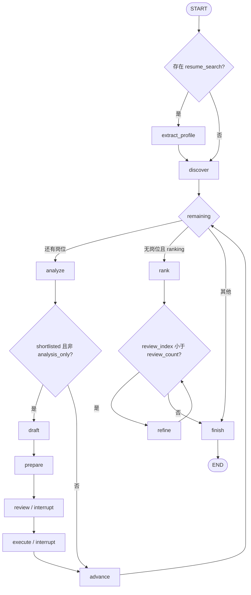

# JobPilot 项目交接说明

交接日期：2026-10-15。原业务基准：`85b52f8`；按用户追加要求，本轮增加历史搜索清理按钮，随后整理交接和复验。最终源码提交的准确版本见 ZIP 中的 `HANDOFF_MANIFEST.json`，也会在交付答复中给出。

面向对象：Python 初学者、接手导师、代码审查者和面试准备者。所有路径相对项目根目录；源码入口可配合 [KEY_CODE_INDEX.md](KEY_CODE_INDEX.md) 阅读。本文区分“代码已经实现”“自动化测试通过”“真实网站实测通过”，三者不能互相代替。历史网站验收发生在特定账号和日期，不保证今天或另一台机器仍可访问。

## 阅读导航

1. 项目目标与实际能力；2. 完整目录及职责；3. 启动与调用链；4. 核心业务；5. Agent 与图；6. 工具；7. 数据模型；8. LLM。
9. 招聘网站与浏览器；10. 数据库；11. HTTP 与页面；12. MCP；13. Evaluation；14. 测试；15. 配置；16. 依赖。
17. 安装部署；18. 实际 Demo；19. 错误与恢复；20. 设计决策；21. 限制与技术债；22. Git 历史；23. 学习顺序；24. 面试准备。

## 1. 项目最终目标和实际能力

JobPilot 是本机运行的求职辅助程序：读取用户简历，按意向与城市发现岗位，保留能核验的经历证据，解释匹配和缺口，并保存工作进度。它帮助筛选和准备沟通，不保证录用，也不保证覆盖网站所有岗位。

### 1.1 用户完整流程

1. 双击 `start.cmd`，进入 `app/server.py:main`，打开本机页面。已有同一数据目录的服务时复用它。
2. 在“连接 DeepSeek”中保存自己的密钥并测试，或选择虚构资料体验。密钥不发给导师。
3. 在左侧粘贴简历或上传文字型 PDF/DOCX/TXT/Markdown；`extract_resume` 提取后回填同一文本框。检查正文、填写一次岗位意向和必填城市；时间选填。
4. 点击“帮我找岗位”。`POST /api/search` 创建只读排名任务，后台 `WorkflowWorker.run` 执行图；页面通过状态快照显示进度。
5. 模型提炼简历并生成相近搜索词。网站先按城市搜索，返回的岗位再标准化、过滤、去重；逐条分析、匹配、评分，对前五名复核。
6. 达到数量上限后可点击“继续搜索（增加 50 条）”。沿用原任务条件与旧结果，总额度最多 1000；增加额度不保证新增同样数量的有效岗位。
7. 如果选择 BOSS 并准备联系，勾选结果、核对账号默认招呼与在线简历，明确批准。`BossContactService` 才允许扩展执行对应岗位的“立即沟通”。
8. 任务、匹配结果、动作和跟踪状态保存到本机。验证或未知发送结果会暂停；人工处理后继续，恢复不等于批准。
9. 在“以前的搜索”点击“清理历史搜索”，确认后删除已结束的只读搜索、检查点和采集缓存。进行中、暂停以及有联系记录的任务保留；当前输入框不会被清空。

### 1.2 必须区分的三条流程

| 流程 | 入口与代码 | 实际行为 |
| --- | --- | --- |
| 日常简历排名 | `app/web/app.js` → `create_app.search_resume` → `build_graph` | `ranking=True, analysis_only=True`；不自动生成待发送草稿，不自动联系；前五名做详细复核 |
| 教学/旧通用审批 | `app/workflow_cli.py` 或 `POST /api/runs` | 严格筛选 → 分析匹配 → `GreetingGenerator.generate` → PendingAction → 人工审批；Mock 可模拟执行；真实通用执行器仍会暂停 |
| BOSS 真实批量联系 | `app/web/batch.js` → `app/api/boss_contact.py` → `BossContactService` → `contact.mjs` | 已完成排名结果中最多选 20 条，批准后点击网站按钮；发送效果来自账号默认招呼及在线简历规则，不发送 JobPilot AI 草稿，不上传附件 |

### 1.3 能力与证据

| 能力 | 状态与证据 | 不能夸大的部分 |
| --- | --- | --- |
| 核心离线流程 | `MockJobAdapter`、fixtures、pytest、Evaluation 可运行 | 离线词表不是大模型；虚构候选人不是用户本人 |
| 真实 DeepSeek | 既往连接、少量真实岗位分析和六个合成样本评估通过，见 `docs/verification.md` | 本次交接不调用付费模型；准确率不代表大样本生产效果 |
| BOSS 读取 | 普通浏览器扩展；已验证滚动三屏、40 次详情尝试得到 37 条完整岗位及断线恢复；2026-10-14 上海搜索得到 1 条完整岗位 | 未重新验收线上连续追加 50 条或长期稳定性；旧 Playwright 路径不可当正常入口 |
| 牛客读取 | 持久 Edge + Playwright；已验证登录、详情、上海搜索及少量 AI 匹配 | 登录失效、网站验证、改版仍会阻断 |
| 实习僧读取 | 公开 HTML Adapter 曾完成读取与匹配 | 2026-10-14 返回 403，当前线上城市搜索未验收；不绕过限制 |
| 真实联系 | 2026-10-12 经用户批准，BOSS 两条岗位显示“继续沟通”，Tracker/检查点一致 | 仅默认招呼，不是附件投递；不支持其他平台发送 |
| PDF | pypdf 文字层提取、中文回填、异常文件回归通过 | 无 OCR；复杂排版仍须本人检查 |
| 持久化与部署 | SQLite 默认；PostgreSQL、Alembic、Docker 独立部署、恢复和沙箱验证通过 | 不自动搬迁个人历史库；容器真实 DeepSeek 配置有已知缺口，见第 21 节 |

## 2. 完整目录树与每个文件的作用

下面按实际交付源码清单生成，不省略测试、fixtures 或迁移文件。目录中没有 `.git`、`.venv`、`.runtime`、`.env`、`.idea`、缓存、个人数据或浏览器资料。带 `.example` 的候选人与所有 fixtures 均为虚构样例。

交付源码共 **219 个文件**（另加 ZIP 清单）。

```text
JobPilot/
├── .github/
│   └── workflows/
│       └── verify.yml  # 离线、PostgreSQL、Compose 验证任务
├── app/
│   ├── adapters/
│   │   ├── mock/
│   │   │   ├── __init__.py  # Python 包标记或公开导出
│   │   │   └── adapter.py  # 从本地文件读取固定的岗位样本，无需浏览器或网络
│   │   ├── __init__.py  # Python 包标记或公开导出
│   │   ├── base.py  # 定义 Phase 1 的岗位来源接口，目前只支持读取岗位
│   │   ├── boss.py  # BOSS 直聘只读入口，平台路径和页面结构留在 Adapter 内
│   │   ├── boss_cities.json  # BOSS 城市名与原生搜索编号映射
│   │   ├── browser_adapter.py  # 将平台 DOM 转换为统一岗位；过滤、匹配和跟踪不接触选择器
│   │   ├── cities.py  # 只处理搜索地点名称和网站参数；城市筛选不依赖模型猜测
│   │   ├── factory.py  # 统一创建平台资源，工作流与工具服务无需了解选择器
│   │   ├── http_reader.py  # 读取公开 HTML；只发有限的 GET，不加载脚本、不使用浏览器登录资料
│   │   ├── nowcoder.py  # 牛客实习岗位读取；平台字段解析全部留在此 Adapter
│   │   └── shixiseng.py  # 实习僧公开页面适配：列表取编号，详情取正文，拒绝猜测特殊字体内容
│   ├── api/
│   │   ├── __init__.py  # Python 包标记或公开导出
│   │   ├── boss_bridge.py  # BOSS 助手的连接与采集 API：独立凭据不能访问简历或批准操作
│   │   ├── boss_contact.py  # 批量联系的本机审批接口与扩展执行接口，二者权限严格分开
│   │   ├── server.py  # 本地 API：候选人输入、任务管理、审批与有限时长的 SSE 状态流
│   │   └── worker.py  # 单工作线程执行同步图，HTTP 请求不等待浏览器或模型返回
│   ├── browser/
│   │   ├── __init__.py  # Python 包标记或公开导出
│   │   ├── bridge.py  # 普通浏览器与本机任务之间的只读队列，不接收简历、Cookie 或任意脚本
│   │   ├── diagnostics.py  # 按页面身份记录只读导航和生命周期；不改变启动参数或网页行为
│   │   ├── manual_login.py  # 人工登录入口：启动正常 Edge 窗口，不连接调试接口，也不读取登录表单
│   │   ├── selectors.py  # 集中维护平台页面结构；选择器失效时修改这里，不改业务服务
│   │   └── session.py  # 复用专属浏览器资料，保留正常登录；不绕过任何验证机制
│   ├── evaluation/
│   │   ├── __init__.py  # Python 包标记或公开导出
│   │   ├── gates.py  # 给评估结果设置明确门槛；未测量和无效数值不能被当成通过
│   │   ├── metrics.py  # 评分逻辑独立于业务服务，输入预测与人工标签后计算指标
│   │   └── runner.py  # 读取固定标签，保存带分母、运行模式和范围说明的 JSON 评估报告
│   ├── llm/
│   │   ├── __init__.py  # Python 包标记或公开导出
│   │   ├── base.py  # 只约定结构化调用，不让业务服务依赖具体模型供应商
│   │   ├── client.py  # OpenAI 兼容的结构化输出客户端；配置只从进程环境或本地 .env 读取
│   │   └── offline.py  # 有限词表的离线替身，用于可重复演示；不宣称具备模型的语义能力
│   ├── models/
│   │   ├── __init__.py  # Python 包标记或公开导出
│   │   ├── action.py  # 审批使用完整快照，避免用户批准 A 内容后程序却发送 B 内容
│   │   ├── analysis.py  # 分析、匹配和沟通草稿的数据结构；每个候选人优势必须能追溯到原资料
│   │   ├── application.py  # 定义本地申请记录；保存状态本身不会向招聘方发送任何内容
│   │   ├── base.py  # 提供各类数据模型共用的校验规则，不处理具体业务
│   │   ├── candidate.py  # 定义候选人资料，只保存本人明确提供的事实和求职条件
│   │   ├── job.py  # 定义各招聘来源共用的岗位数据，以及规则筛选结果
│   │   ├── resume.py  # 页面提交的当前表单；沿用 CandidateProfile，不保存另一份确认状态
│   │   └── search.py  # 简历驱动的搜索输入与 AI 输出；原文证据和排序判断分开保存
│   ├── services/
│   │   ├── __init__.py  # Python 包标记或公开导出
│   │   ├── action_service.py  # 外部操作唯一执行入口；不确定结果保留记录，避免重复发送
│   │   ├── analysis_service.py  # 分析 JD 后核对引用；模型生成的字段不能越过原文边界
│   │   ├── boss_contact.py  # BOSS 批量联系：复用 PendingAction，只在本机用户批准后发放单次执行许可
│   │   ├── deduplication_service.py  # 按来源岗位编号和整理后的岗位链接去重，无需数据库或外部服务
│   │   ├── filter_service.py  # 用明确的求职条件筛选岗位，并记录原因；不进行语义分析或能力推测
│   │   ├── greeting_service.py  # 模型选择沟通重点，程序只引用候选人原有证据来组织草稿
│   │   ├── history_service.py  # 清理已经结束的纯搜索历史；联系凭据和仍在使用的数据始终保留
│   │   ├── matching_service.py  # 保守地核对已提供的技能，避免把模型推测写成候选人事实
│   │   ├── model_settings.py  # 本机 DeepSeek 设置：密钥只写入忽略提交的 .env，不出现在接口响应中
│   │   ├── normalization_service.py  # 按固定规则清理不同来源的岗位，使后续筛选和去重使用一致的数据
│   │   ├── ranking_service.py  # 保留时间有差距的机会，用公开的分项分数排序，再解释靠前的岗位
│   │   └── resume_service.py  # 读取简历正文，校验人工或 AI 提取的每条证据，不补写候选人经历
│   ├── storage/
│   │   ├── __init__.py  # Python 包标记或公开导出
│   │   ├── actions.py  # 审批记录的事务存储；独立数据库不影响原有 SQLiteTracker
│   │   ├── relational.py  # 新的 Agent 数据使用同一套 SQLAlchemy 表定义，兼容 SQLite 与 PostgreSQL
│   │   └── tracker.py  # 用 SQLite 保存本地数据，并检查用户确认后的申请状态变更
│   ├── tools/
│   │   ├── __init__.py  # Python 包标记或公开导出
│   │   └── jobs.py  # 岗位工具白名单，禁止通过此入口执行任意 URL、脚本或发送操作
│   ├── web/
│   │   ├── api.html  # 本地 API 文档页
│   │   ├── app.js  # 任务提交、状态流、结果渲染和历史清理
│   │   ├── batch.js  # 勾选岗位、明确批准和联系结果核查
│   │   ├── boss.js  # BOSS 扩展配对及连接状态
│   │   ├── index.html  # 简历、搜索、历史与结果页面
│   │   ├── resume.js  # 当前简历输入与文件导入
│   │   ├── settings.js  # DeepSeek 保存和连接测试
│   │   └── style.css  # 响应式布局与组件样式
│   ├── workflow/
│   │   ├── __init__.py  # Python 包标记或公开导出
│   │   ├── checkpoints.py  # 搜索图与联系图共用检查点后端，按 thread_id 区分各自的恢复位置
│   │   ├── contact_graph.py  # 批量联系的持久恢复图：等批准、等浏览器、等回执，不能代替用户批准
│   │   ├── graph.py  # 按岗位循环的 LangGraph：读取、过滤、分析、草稿、审批、执行与记账
│   │   └── runtime.py  # 为一次图调用准备资源，退出时关闭浏览器与数据库连接
│   ├── __init__.py  # Python 包标记或公开导出
│   ├── approval_cli.py  # 人工查看、批准、拒绝待执行动作；真实动作不会交给模拟执行器
│   ├── browser_cli.py  # 浏览器只读命令；人工登录仅在明确执行 login 时打开交互窗口
│   ├── config.py  # 读取程序配置，并把文件路径转换成明确的绝对路径
│   ├── db_cli.py  # 显式执行数据库升级；不会自动删除旧 SQLite 或迁移真实资料
│   ├── enums.py  # 集中定义固定选项，让模型、筛选规则和数据库使用相同的名称
│   ├── exceptions.py  # 定义可以预期的业务异常，交给命令行入口统一显示和处理
│   ├── intelligence_demo.py  # Phase 2 的离线或真实模型演示；原 Phase 1 CLI 保持可用
│   ├── logging_config.py  # 配置标准库日志，供命令行入口记录运行编号、步骤、结果和耗时
│   ├── main.py  # 程序入口：把读取、筛选、去重和保存串成一条清晰的数据流
│   ├── mcp_client.py  # MCP 客户端通过官方 SDK 握手和调用工具，不伪装成本地函数分派
│   ├── mcp_server.py  # 独立 stdio MCP 服务器，只暴露岗位搜索和详情两个只读工具
│   ├── observability.py  # 结构化运行事件只记录允许字段，不把密钥、Cookie 或简历正文写入日志
│   ├── reliability.py  # 小规模单机部署的互斥、限流与有限重试，不引入没有必要的 Redis
│   ├── runtime_config.py  # 后续阶段专用配置，保持原 Phase 1 的配置兼容
│   ├── server.py  # 默认只监听本机；多用户部署前需要额外的身份与权限设计
│   └── workflow_cli.py  # 有状态任务的启动、查看和恢复入口
├── docker/
│   ├── chromium-seccomp.json  # 容器 Chromium 沙箱系统调用规则
│   ├── LICENSE.playwright  # 上游沙箱规则的许可证
│   └── NOTICE.txt  # 沙箱规则来源与版本说明
├── docs/
│   ├── architecture.md  # 架构和模块边界
│   ├── browser-login-diagnosis.md  # BOSS 浏览器冲突诊断历史
│   ├── demo.md  # 本机及部署 Demo 操作
│   ├── file-guide.md  # 文件阅读导航
│   ├── KEY_CODE_INDEX.md  # 30 项关键代码及调用关系
│   ├── phase-0-1-report.md  # 早期 Mock 和规则阶段验收
│   ├── phases.md  # 各阶段实施与完成记录
│   ├── PROJECT_HANDOFF.md  # 完整项目交接与学习说明
│   ├── pycharm-interpreter-diagnosis.md  # 解释器与 IDE 问题排查
│   └── verification.md  # 按日期记录的验收证据
├── extensions/
│   └── boss_readonly/
│       ├── background.js  # 扩展后台连接消息与助手入口
│       ├── collector.mjs  # 等待可见页面并提取岗位详情
│       ├── connect.js  # 本机页面与扩展连接桥
│       ├── contact.mjs  # 批准后核对目标并执行一次沟通
│       ├── core.mjs  # 受限本机接口和浏览器公共能力
│       ├── helper.html  # 日常助手页面结构
│       ├── helper.mjs  # 助手心跳、领取任务、采集和联系循环
│       ├── manifest.json  # 入口、权限和允许主机
│       ├── panel.css  # 助手与诊断面板样式
│       ├── panel.html  # 独立只读诊断面板
│       ├── panel.mjs  # 诊断按钮与输出
│       ├── probe.mjs  # 正常浏览器只读探测
│       ├── README.md  # 扩展安装、使用和权限说明
│       ├── search.mjs  # 城市搜索、列表滚动与续页
│       └── selectors.json  # 扩展集中选择器
├── fixtures/
│   ├── browser/
│   │   ├── boss_detail.html  # 合成网站 HTML，供离线解析与浏览器回归
│   │   ├── boss_search.html  # 合成网站 HTML，供离线解析与浏览器回归
│   │   ├── boss_search_delayed.html  # 合成网站 HTML，供离线解析与浏览器回归
│   │   ├── nowcoder_detail.html  # 合成网站 HTML，供离线解析与浏览器回归
│   │   ├── nowcoder_search.html  # 合成网站 HTML，供离线解析与浏览器回归
│   │   ├── shixiseng_detail.html  # 合成网站 HTML，供离线解析与浏览器回归
│   │   └── shixiseng_search.html  # 合成网站 HTML，供离线解析与浏览器回归
│   ├── evaluation/
│   │   ├── gold.json  # 合成 JD、匹配和工具正确答案
│   │   └── thresholds.json  # 评估质量门槛
│   ├── jobs/
│   │   ├── 01_agent_engineer.json  # 虚构岗位样本：01_agent_engineer
│   │   ├── 02_llm_application.json  # 虚构岗位样本：02_llm_application
│   │   ├── 03_ai_backend.json  # 虚构岗位样本：03_ai_backend
│   │   ├── 04_rag.json  # 虚构岗位样本：04_rag
│   │   ├── 05_chinese_llm.json  # 虚构岗位样本：05_chinese_llm
│   │   ├── 06_agent_tools.json  # 虚构岗位样本：06_agent_tools
│   │   ├── 07_rag_platform.json  # 虚构岗位样本：07_rag_platform
│   │   ├── 08_llm_engineering.json  # 虚构岗位样本：08_llm_engineering
│   │   ├── 09_agent_workflow.json  # 虚构岗位样本：09_agent_workflow
│   │   ├── 10_llm_backend.json  # 虚构岗位样本：10_llm_backend
│   │   ├── 11_rag_engineer.json  # 虚构岗位样本：11_rag_engineer
│   │   ├── 12_agent_id_duplicate.json  # 虚构岗位样本：12_agent_id_duplicate
│   │   ├── 13_llm_url_duplicate.json  # 虚构岗位样本：13_llm_url_duplicate
│   │   ├── 14_frontend.json  # 虚构岗位样本：14_frontend
│   │   ├── 15_frontend.json  # 虚构岗位样本：15_frontend
│   │   ├── 16_testing.json  # 虚构岗位样本：16_testing
│   │   ├── 17_testing.json  # 虚构岗位样本：17_testing
│   │   ├── 18_cv_algorithm.json  # 虚构岗位样本：18_cv_algorithm
│   │   ├── 19_cv_algorithm.json  # 虚构岗位样本：19_cv_algorithm
│   │   └── 20_sales.json  # 虚构岗位样本：20_sales
│   └── candidate.example.json  # 明确虚构的候选人
├── migrations/
│   ├── versions/
│   │   └── 0001_agent_state.py  # 建立 Agent、岗位、审批和任务索引表；不修改 Phase 1 的旧表
│   └── env.py  # 迁移连接从 AGENT_DATABASE_URL 读取，不在配置文件提交数据库密码
├── scripts/
│   ├── browser_smoke.py  # 用本地响应驱动真实浏览器，验证 DOM 解析和人工验证暂停，不连接平台
│   ├── build_browser_probe.py  # 把现有集中选择器导出给只读扩展，避免维护两套平台选择器
│   ├── dashboard_smoke.py  # 使用真实本地 HTTP 服务和 Edge 完成页面操作，并保存截图供人工查看
│   ├── deployment_check.py  # 不依赖 Docker 守护进程的部署预检；不能代替实际镜像构建与容器启动
│   ├── docker_smoke.py  # 创建独立 Compose 测试项目，验证部署和重启恢复；不复用用户数据卷
│   ├── lifecycle_smoke.py  # 用合成页面验证多窗口身份、关闭事件和普通 HTTPS 对照入口
│   ├── mcp_smoke.py  # 让真正的工作流通过 MCP 子进程读取岗位，然后停在审批节点
│   ├── navigation_smoke.py  # 用本地脚本跳转样本验证导航诊断，不向招聘网站发请求
│   ├── platform_smoke.py  # 用真实浏览器读取指定平台的本地合成页面，验证统一 Adapter 契约
│   ├── recovery_smoke.py  # 无需 Docker，在本机重启真实 HTTP 服务验证持久审批和完整 Mock 流程
│   ├── stream_smoke.py  # 用本地合成状态流验证正常断流续接和有限网络重试，不等待一分钟
│   └── system_smoke.py  # 对已经启动的本机服务验收 Mock 全流程，供本地和容器共用
├── tests/
│   ├── browser_probe/
│   │   ├── contact.test.mjs  # 扩展联系批准、目标核对和防重复回归
│   │   ├── probe.test.mjs  # 探测页面等待与读取边界回归
│   │   └── search.test.mjs  # 城市、滚动、续页和额度回归
│   ├── integration/
│   │   ├── test_agent_graph.py  # 真实 LangGraph 和 SQLite 检查点的跨实例恢复测试
│   │   ├── test_analysis_only.py  # 公开读取、规则和证据匹配必须连通，且不得进入草稿或执行节点
│   │   ├── test_boss_bridge.py  # 用虚构 BOSS 页面数据验收桥接、权限隔离和原工作流的断点恢复
│   │   ├── test_boss_contact.py  # 用临时数据库模拟用户审批和扩展回执；不连接 BOSS、不点击真实岗位
│   │   ├── test_history_cleanup.py  # 历史清理必须真正删掉搜索副本，同时保住联系记录、共享资料和恢复边界
│   │   ├── test_http_api.py  # API 通过真实工作线程和临时数据库验证鉴权、审批以及状态流
│   │   ├── test_mcp_protocol.py  # 真实 MCP 子进程握手与工具调用；没有以函数替身冒充协议测试
│   │   ├── test_model_settings.py  # 本机页面可配置模型；鉴权、原配置、密钥保密与测试调用均需保留
│   │   ├── test_ranked_workflow.py  # 新搜索沿用同一 LangGraph；失败恢复不能重新提炼或重复生成动作
│   │   ├── test_relational_storage.py  # 验证迁移、并发批准和平台去重；有专用 PG 测试库时再跑真实驱动
│   │   ├── test_resume_api.py  # 验证简历入口的权限、真实流式限额和原文证据到审批的完整链路
│   │   ├── test_search_expansion.py  # 扩大搜索沿用原任务、城市与检查点；旧岗位不重复分析，审批不受影响
│   │   ├── test_system_recovery.py  # 通过真实回环 HTTP 与新服务实例验证恢复，而不是复用内存中的图
│   │   └── test_workflow.py  # 离线运行真实命令行程序，并跨进程重开数据库，检查完整流程和持久化结果
│   ├── unit/
│   │   ├── test_approval.py  # 验证批准绑定内容、幂等领取以及不确定结果的保守处理
│   │   ├── test_browser_adapter.py  # 浏览器契约测试：这些虚构样本不代表平台当前 DOM 已经验收
│   │   ├── test_browser_diagnostics.py  # 验证页面身份、异常生命周期、对照入口，以及 URL 敏感字段的过滤
│   │   ├── test_browser_probe_contract.py  # 扩展选择器不能漂移，导出完整岗位必须能进入现有统一模型
│   │   ├── test_browser_session.py  # 验证提前关窗与驱动异常时，专用浏览器锁仍能可靠释放
│   │   ├── test_config.py  # 验证配置的默认值、覆盖顺序和路径解析，避免受启动目录或终端环境影响
│   │   ├── test_deduplication.py  # 验证按平台标识和网址去重时，既能合并重复岗位，也不会误删独立岗位
│   │   ├── test_deepseek.py  # 不调用真实模型，核对 DeepSeek 协议、完整输出和本地证据校验
│   │   ├── test_evaluation_gates.py  # 用质量下降、零样本和模型错误验证门禁不会静默通过
│   │   ├── test_evaluation_metrics.py  # 用错误预测检验评分器，防止指标始终返回满分
│   │   ├── test_filter.py  # 验证规则筛选遵守候选人明确填写的条件，并说明每项拒绝原因
│   │   ├── test_intelligence.py  # 检验结构化输出和证据边界，避免模型幻觉流入候选人描述
│   │   ├── test_launcher.py  # 启动器只在服务就绪后打开页面，不把本机连接码放入 HTTP 查询参数
│   │   ├── test_manual_login.py  # 人工登录只打开指定网站和项目资料目录，不接入自动化控制
│   │   ├── test_mock_adapter.py  # 验证模拟适配器能稳定读取离线样例，并在数据有误时提供清楚的错误信息
│   │   ├── test_models.py  # 验证数据模型能在筛选和入库前拦住无效数据，并保留有效信息
│   │   ├── test_nowcoder_adapter.py  # 牛客样本是合成数据，字段结构取自公开页面核对结果
│   │   ├── test_ranked_search.py  # 验证软时间条件、可解释评分与模型引用边界，不调用真实模型
│   │   ├── test_reliability.py  # 验证重试边界、进程锁和日志白名单，避免可靠性功能引入重复副作用
│   │   ├── test_resume.py  # 用虚构简历验证正文读取和来源约束，不接触用户真实资料
│   │   ├── test_search_cities.py  # 城市先传给网站，再在岗位层复核；续读缓存不能重复拉取已读详情
│   │   ├── test_shixiseng_adapter.py  # 公开 HTTP 与实习僧解析的离线契约，不代替真实网站可用性验收
│   │   ├── test_storage.py  # 验证数据库重开后的数据恢复、岗位去重，以及需要人工确认的状态修改
│   │   └── test_worker_queue.py  # 让工作线程暂不开始，稳定复现恢复请求返回后仍显示旧暂停状态的问题
│   ├── conftest.py  # 提供离线测试共用的候选人和岗位样例，减少重复准备数据的代码
│   └── pdf_samples.py  # 内存中的虚构 PDF 样本；没有真实简历，也不保存上传文件
├── .dockerignore  # 排除镜像中的个人资料和缓存
├── .env.example  # 无真实凭据的配置样例
├── .gitattributes  # 统一文本换行
├── .gitignore  # 忽略环境、凭据和运行数据
├── .python-version  # 固定 Python 3.12
├── alembic.ini  # 数据库迁移入口配置
├── compose.yaml  # 编排数据库、迁移、应用和数据卷
├── Dockerfile  # 安装运行环境并以非 root 启动容器
├── pyproject.toml  # 项目元信息、Python 版本与测试配置
├── README.md  # 日常安装、启动、能力和限制
├── requirements-dev.txt  # 开发测试依赖
├── requirements.lock.txt  # 可重复安装的锁定版本
├── requirements.txt  # 运行依赖及允许版本范围
└── start.cmd  # Windows 一键启动入口
```

`data/`、`profiles/` 等运行目录不进入交付包，首次运行时按需创建。ZIP 额外含 `HANDOFF_MANIFEST.json`：记录源码提交、文件清单和 SHA-256，便于核对交接包。它不是业务代码。

## 3. 程序启动流程：从命令到任务结束

### 3.1 日常页面入口

```text
start.cmd
  → 使用项目 .venv/Scripts/python.exe，切换至脚本所在目录
  → python -m app.server --open-browser
  → app/server.py:main
      → local_token(data_dir)：从环境配置或本机文件读取/生成访问凭据
      → open_existing_server：核对 /api/instance；同库已运行就打开原页面
      → app/api/server.py:create_app
          → agent_database_url → SQLite 时 upgrade → database_engine
          → RunStore / RelationalActionStore / RelationalTracker
          → WorkflowWorker + install_boss_routes + install_contact_routes
      → uvicorn.Server.run，单进程监听 127.0.0.1:8000
      → open_when_ready → 浏览器打开首页
```

`open_when_ready` 把访问凭据放到 URL 的 `#` 片段；`app/web/settings.js` 读取后移除片段，连接成功后保存到当前会话的 `sessionStorage`；`app.js:api` 请求头附 `X-JobPilot-Token`。不是公开可用的登录系统。

```text
app/web/resume.js:readSearchForm
  → app/web/app.js:#search-form.onsubmit
  → POST /api/search
  → create_app.search_resume
      → normalize_cities / boss_search_cities
      → create_llm('live') 仅检查配置
      → RunStore.create → WorkflowWorker.submit
  → WorkflowWorker.run（后台唯一工作线程）
      → open_graph → open_adapter 或 BossExtensionAdapter
      → open_checkpointer → build_graph
      → graph.stream(..., stream_mode='values')
      → 每个快照 RunStore.update
      → graph.get_state → 有 next/interrupt 则 PAUSED，否则 COMPLETED
  → GET /api/runs/{id}/events → app.js:selectRun / showState
```

真正的节点调用关系见第 5 节。界面请求没有等浏览器与模型执行完才返回，而是立即获得任务编号。

### 3.2 教学 CLI 入口

`python -m app.main` → `main` → `build_parser` → `load_settings` → `execute_cli` → `load_candidate` → `SQLiteTracker` → `MockJobAdapter` → `run_search` → 标准化/过滤/去重/保存。结束退出码 0；业务异常为 1，参数错误通常为 2。该入口不运行排名图、不调用真实网站或模型。

`python -m app.workflow_cli start ...` → `app/workflow_cli.py:main` → `open_graph` → `graph.invoke`；后续 `resume` 使用原 run_id 与目录。`app/approval_cli.py:main` 负责旧审批，不是新版 BOSS 批量页面的替代入口。

## 4. 核心业务流程

| 步骤 | 真实实现 | 输入 → 输出；关键规则 |
| --- | --- | --- |
| 岗位发现 | `JobSourceAdapter.search_jobs`、`open_adapter`、`ReadonlyBrowserAdapter.search_pages`、`BossExtensionAdapter.search_jobs` | 搜索词/城市/额度 → `list[JobPosting]`；Adapter 不做候选人匹配 |
| 标准化 | `app/services/normalization_service.py:normalize_job, canonicalize_url` | 清理文字、来源与 URL；删除已知跟踪参数，保留岗位身份参数 |
| 硬筛 | `RuleFilter.evaluate`；新页面用 `ranking_service.search_filter` | `CandidateProfile + JobPosting` → `FilterResult`；新页面城市、明确类型、下线和截止为硬条件，时间为软条件 |
| 去重 | `deduplication_service.deduplicate_jobs`；Tracker 唯一约束 | 来源+平台编号或标准化 URL；保留先出现记录，不靠相似标题猜同一岗位 |
| JD 分析 | `JobAnalyzer.analyze/validate` | JD → `JobAnalysis` 或 `SearchJobAnalysis`；技能要求必须有 JD 原文引用 |
| 候选人匹配 | `CandidateMatcher.match`、`skill_key` | 显式技能与少量明确别名比较；已有/学习中/缺失分别标记，返回双方证据 |
| 评分 | `score_match` | 技能 70、意向 20、时间 10；必需技能权重 3，优先技能 1；学习中计半份；不是录用概率 |
| 前列复核 | `review_match`、图内 `refine` | 模型挑选已有证据序号和 JD 顾虑；程序组织解释；前五名逐个落盘 |
| 草稿 | `GreetingGenerator.generate` | `GreetingPlan` 选最多三个合法证据编号；程序引用原文生成 `GreetingDraft`；新版只读排名不经过此节点 |
| 人工批准 | `ActionStore/RelationalActionStore.decide`、`BossContactService.decide` | 内容摘要核对通过才从 PENDING 转 APPROVED；批量变动时旧确认无效 |
| 外部动作 | 通用 `ApprovalService.execute`；真实 BOSS `BossContactService.authorize/finish` + `contact.mjs` | 批准先落盘，执行许可单次消费；结果不明进入 UNCERTAIN，不自动重发 |
| 跟踪 | `SQLiteTracker/RelationalTracker`、图内 `record_progress` | 分析等阶段推进本地记录；只有真实成功或本人核查才自动标 CONTACTED，不覆盖面试/归档 |
| 状态工作流 | `build_graph`、`build_contact_graph` | 检查点保存执行位置；恢复继续原任务，不重新创建全部步骤 |
| 评估 | `evaluation.runner.evaluate`、`assess_report` | 固定合成标签 + 工具事件 + 恢复注入 → 带分母和范围的报告 |

`CandidateMatcher` 的 `shortlisted=True` 只表示存在技能交集；它不是“所有硬条件都满足”或“可以自动联系”。新页面保留没有交集但方向未明确无关的岗位，按低分显示差距。

## 5. Agent 架构、节点和恢复

### 5.1 为什么称为 Agent 工作流，以及边界

项目有模型理解与搜索词生成、调用环境工具、观察结果、持久状态、按结果分支、人工反馈与恢复，因此可称为**受约束的 Agent 工作流**。但图结构和工具调用是开发者预定义的：不是 ReAct 自由规划器，没有让 LLM 自由选择任意工具，也没有自主修改自身计划的通用多智能体系统。`Tool Selection Accuracy` 测的是确定性路由。面试时应主动说明这一点。

普通 `main.run_search` 是一次确定性流水线；`build_graph` 在此基础上加入模型节点、按岗位循环、人工中断、保存执行状态；增加 LangGraph 并不自动证明“更智能”。

### 5.2 搜索图：全部 11 个节点

定义全部位于 `app/workflow/graph.py:build_graph` 内部。

| Node/函数 | 做什么 | 后续边 |
| --- | --- | --- |
| `extract_profile` | `analyze_resume` 提炼并核验简历、生成查询词、保存用量 | 固定到 discover |
| `discover` | 工具读取、标准化、过滤、去重、保存 Tracker；续搜合并旧结果 | `remaining`：有岗位→analyze；无待分析且排名→rank；否则 finish |
| `analyze` | JD 分析、CandidateMatcher、可选 score_match、Tracker 推进 | shortlist 且非只读→draft；否则 advance |
| `draft` | 生成带证据的草稿 | prepare |
| `prepare` | 保存 PENDING 完整快照与摘要 | review |
| `review` | 未决定就 `interrupt`；恢复后重读动作表 | execute；仍 PENDING 则报错 |
| `execute` | 通过 ApprovalService 执行；验证码/结果未知时 interrupt | advance；等待期间在节点内循环 |
| `advance` | 当前岗位结果追加到 results，index 加一 | `remaining` 决定下一条或结束 |
| `rank` | 排除明确 unrelated、按分数降序并用岗位 ID 打破同分；选择前五名 | 尚有复核→refine，否则 finish |
| `refine` | 一次复核一条；已有 deep_review 则跳过 | 复核未结束→自身，否则 finish |
| `finish` | 状态写 COMPLETED | END |



普通边代表固定下一步；条件边由 Python 返回节点名，不由模型返回任意跳转。循环共有：岗位循环 `advance→remaining→analyze`、复核循环 `refine→refine`、浏览器验证后的 discover 重试、未知执行结果等待；不是无限后台刷网站。

### 5.3 AgentState 与任务索引的区别

`AgentState` 是 `TypedDict(total=False)`，完整字段解释见第 7 节。字段按来源、候选人、列表/游标、当前结果、累计结果、排名、用量分组。里面只放可序列化数据，不放浏览器对象、数据库连接或 API Key。节点返回局部字典，由 LangGraph 合入状态；没有自定义列表 reducer，因此节点要显式保留旧 results/usage。

`RunStore` 的 agent_runs 则保存 API 能展示的 `input/snapshot/interrupts/next/error/status`。它是索引与快照，不是替代 Checkpoint 的第二套执行器。两者并非同一跨库原子事务，因此必须测试崩溃间隙。

### 5.4 Pause / Resume / Checkpoint

- `graph_config(run_id)` 用 `configurable.thread_id=run_id`，recursion_limit=4000。
- `open_checkpointer`：SQLite 用 `data_dir/checkpoints.db` 的 `SqliteSaver`；PostgreSQL 用 `PostgresSaver`。`app/db_cli.py:upgrade` 负责 PostgreSQL saver.setup。
- `interrupt({...})` 保存中断；`WorkflowWorker.run` 同时检查 `state.next` 和 tasks 内 interrupts，不能只看 next。
- 恢复已有中断用 `Command(resume=True)`；异常后待执行节点用 `None`；首次才传输入字典。中断节点可能从头重跑，所以外部副作用必须先独立持久化批准/领取事实。
- 续搜先 `RunStore.expand_search` 条件更新额度并标 QUEUED；worker 发现输入额度高于图状态，`graph.update_state(..., as_node='extract_profile')` 将执行位置设到 discover。这里不会再次调用 extract_profile。旧候选人、已读详情和分析保留。
- 工作线程出错写 FAILED，保留检查点；用户处理原因后恢复。不是任意异常都会自动重试；数据库不可用时最后一份可显示快照也可能落后，必须先修复数据库再核对。

### 5.5 独立联系图

`app/workflow/contact_graph.py:ContactState` 保存 action_id、run_id、observed、stage。每个动作的 thread_id 为 `action:<动作编号>`，与搜索图共用 saver。

```text
START → observe
          ├─ SUCCEEDED / REJECTED → stage=COMPLETED → END
          └─ 其他 → wait_for_event → interrupt → Resume → observe
PENDING→WAITING_APPROVAL；APPROVED→READY 或 WAITING_BROWSER；
EXECUTING→EXECUTING；UNCERTAIN→WAITING_REVIEW。
```

`sync_contact_workflows` 在联系锁下比较动作表快照，有变化才更新图；`BossContactService._sync` 调用它。**联系图本身不点击网页**，只观察持久动作事实；真实点击在扩展。批准、许可、回执先在动作表落盘，再同步图；同步失败不能发出点击许可，下次查询可补齐。测试包括这些步骤之间的退出恢复。

## 6. 所有 Tool 与执行能力

### 6.1 正式工具接口：只有两个

| Tool | 输入模型与约束 | 输出 | 位置/调用者 | 失败处理 |
| --- | --- | --- | --- | --- |
| `search_jobs` | `SearchArguments`：queries 最多 5 个；limit 默认 10，1–1000；cities 最多 10 个 | 进程内 list[JobPosting]；另存 warnings/coverage；MCP 返回 ToolReply | `app/tools/jobs.py:JobTools.call`；`ToolCallingAdapter.search_jobs`；图 discover 调用；MCP 在 create_server 内注册同名工具 | 校验失败抛错；BrowserPausedError 交图 interrupt；其他错误变失败，不装成空列表 |
| `get_job_detail` | `DetailArguments.source_job_id`，非空字符串，最长 200 | 进程内单条或工具封装的岗位列表；MCP ToolReply.jobs | `JobTools.call`、`ToolCallingAdapter.get_job_detail`、`MCPJobAdapter.get_job_detail`；Adapter 搜索内部也会读取详情，但不是每条都由 LLM 发工具调用 | 未找到/下线/不可读分不同异常；工具事件保存 success 与耗时 |

`SCHEMAS` 是白名单。`JobTools.call` 记录 `{tool, arguments, success, latency_ms}`。工具名与参数由图/调用方决定，模型只生成搜索词，不生成浏览器脚本或任意 URL。

### 6.2 不要混称为 MCP Tool 的内部能力

| 能力 | 输入 → 输出 | 代码与调用时机 | 权限/失败 |
| --- | --- | --- | --- |
| 浏览器读取与翻页 | 平台白名单 URL/集中选择器 → HTML | `BrowserSession.read/read_next`；NowcoderAdapter、旧 BOSS Adapter | 只读；登录/验证码/空白页暂停；有沙箱、资料锁和时间限制 |
| 公开 HTTP 读取 | 平台 URL → HTML | `PublicPageReader.read`；ShixisengAdapter | 403/429 等停止并人工处理；不绕验证码，不读取隐藏岗位 API |
| BOSS 普通标签页采集 | 查询词、城市编号、额度、已读编号 → BridgeUpdate | `collectSearch` → `observeTab` → `chrome.tabs/scripting`；助手轮询接任务 | 只读搜索/详情；错误保留页面并暂停，逐条保存结果 |
| 通用执行器 | ActionPayload → 回执字符串 | `ActionExecutor.preflight/send`、`ApprovalService.execute` | Mock 返回模拟回执；UnverifiedPlatformExecutor 对真实发送明确暂停 |
| BOSS 真实联系 | 已批准动作、页面观察、单次许可 → 状态回执 | `BossContactService.authorize/finish` 与 `extensions/boss_readonly/contact.mjs` | 许可前核对编号/标题/公司/唯一按钮，15 秒有效；异常或回执不明变 UNCERTAIN |

这些内部方法不是 MCP 公共工具。模型不能直接批准动作，MCP Server 也没有发消息/投递工具。

## 7. 所有主要数据模型与字段字典

`app/models/base.py:DomainModel` 统一 `extra='forbid'`、去字符串首尾空白、赋值校验；`NonEmptyStr` 要求去空白后非空。Pydantic 只保证结构，事实还要服务层核验。下表类型和默认值来自实际源码；`—` 表示无默认值（Pydantic 中必填），TypedDict 字段只是运行状态声明，`total=False` 允许节点逐步补齐。

以下共 **45 个模型/状态/配置结构，271 个直接声明字段**。继承字段见基类；Field(...) 保留真实约束，default_factory 每次新建独立值。

### 7.1 CandidateSkill

位置：`app/models/candidate.py`。保存候选人自述的技能、熟练程度和相关经历。

| 字段 | 类型 | 默认值与约束 | 作用 |
| --- | --- | --- | --- |
| `skill` | `NonEmptyStr` | `必填` | 简短技能名称 |
| `level` | `SkillLevel` | `必填` | 本人技能程度枚举 |
| `evidence` | `NonEmptyStr` | `必填` | 本人提供的技能经历原文 |

### 7.2 CandidateProfile

位置：`app/models/candidate.py`。保存个人经历和明确的求职条件，供后续规则筛选使用。

| 字段 | 类型 | 默认值与约束 | 作用 |
| --- | --- | --- | --- |
| `id` | `NonEmptyStr` | `必填` | 对象的稳定编号 |
| `name` | `NonEmptyStr` | `必填` | 本人姓名原文 |
| `education` | `list[NonEmptyStr]` | `Field(default_factory=list)` | 学历原文列表 |
| `skills` | `list[CandidateSkill]` | `Field(default_factory=list)` | 技能、程度和证据列表 |
| `projects` | `list[NonEmptyStr]` | `Field(default_factory=list)` | 项目经历原文列表 |
| `experience` | `list[NonEmptyStr]` | `Field(default_factory=list)` | 实习/工作经历原文列表 |
| `target_roles` | `list[NonEmptyStr]` | `Field(default_factory=list)` | 期望岗位名称 |
| `target_cities` | `list[NonEmptyStr]` | `Field(default_factory=list)` | 允许的目标城市 |
| `excluded_roles` | `list[NonEmptyStr]` | `Field(default_factory=list)` | 明确排除的岗位方向 |
| `excluded_keywords` | `list[NonEmptyStr]` | `Field(default_factory=list)` | 明确排除的关键词 |
| `internship_duration_months` | `int \| None` | `Field(default=None, ge=1, le=120, strict=True)` | 候选人可提供的实习月数，未知为 None |
| `available_days_per_week` | `int \| None` | `Field(default=None, ge=1, le=7, strict=True)` | 候选人每周可到岗天数，未知为 None |
| `preferred_keywords` | `list[NonEmptyStr]` | `Field(default_factory=list)` | 旧规则偏好的岗位关键词 |
| `employment_type` | `EmploymentType` | `EmploymentType.ANY` | 实习、全职或不限枚举 |

### 7.3 JobPosting

位置：`app/models/job.py`。用统一字段保存岗位，不依赖浏览器或候选人信息。

| 字段 | 类型 | 默认值与约束 | 作用 |
| --- | --- | --- | --- |
| `id` | `NonEmptyStr` | `必填` | 对象的稳定编号 |
| `source` | `NonEmptyStr` | `必填` | 招聘来源名称 |
| `source_job_id` | `NonEmptyStr` | `必填` | 平台自己的岗位编号 |
| `title` | `NonEmptyStr` | `必填` | 岗位标题 |
| `company` | `NonEmptyStr` | `必填` | 公司名称 |
| `city` | `str \| None` | `None` | 岗位地点 |
| `salary` | `str \| None` | `None` | 网站薪资原文，不推断数值 |
| `description` | `str` | `必填` | 岗位描述正文 |
| `url` | `NonEmptyStr` | `必填` | 岗位地址，由 Adapter 再核对来源 |
| `publish_time` | `AwareDatetime \| None` | `None` | 带时区的岗位发布时间 |
| `hr_activity` | `str \| None` | `None` | 招聘方可见活跃信息 |
| `deadline` | `date \| None` | `None` | 招聘截止日期 |
| `closed_reason` | `str \| None` | `None` | 下线或停止招聘的可见原因 |
| `fetched_at` | `AwareDatetime` | `Field(default_factory=lambda: datetime.now(UTC))` | 本次读取 UTC 时间 |
| `employment_type` | `EmploymentType` | `EmploymentType.ANY` | 实习、全职或不限枚举 |
| `internship_duration_months` | `int \| None` | `Field(default=None, ge=1, le=120, strict=True)` | 岗位要求的实习月数 |
| `required_days_per_week` | `int \| None` | `Field(default=None, ge=1, le=7, strict=True)` | 岗位要求每周到岗天数 |

### 7.4 FilterResult

位置：`app/models/job.py`。保存规则筛选是否通过，以及未通过的具体原因。

| 字段 | 类型 | 默认值与约束 | 作用 |
| --- | --- | --- | --- |
| `passed` | `bool` | `必填` | 是否通过规则 |
| `reasons` | `list[str]` | `Field(default_factory=list)` | 排除的可读原因列表 |

### 7.5 RequirementEvidence

位置：`app/models/analysis.py`。技能要求及 JD 原文，不接受模型自行编造的引用。

| 字段 | 类型 | 默认值与约束 | 作用 |
| --- | --- | --- | --- |
| `skill` | `NonEmptyStr` | `必填` | 简短技能名称 |
| `quote` | `NonEmptyStr` | `必填` | 逐字原文引用，不能补写 |

### 7.6 JobAnalysis

位置：`app/models/analysis.py`。模型对 JD 的结构化理解；未知要求保留为空。

| 字段 | 类型 | 默认值与约束 | 作用 |
| --- | --- | --- | --- |
| `required_skills` | `list[str]` | `Field(default_factory=list)` | JD 明确必需的技能 |
| `preferred_skills` | `list[str]` | `Field(default_factory=list)` | JD 优先或加分的技能 |
| `responsibilities` | `list[str]` | `Field(default_factory=list)` | 岗位职责 |
| `technologies` | `list[str]` | `Field(default_factory=list)` | JD 涉及的技术 |
| `education_requirement` | `str \| None` | `None` | 学历要求，未说明为 None |
| `experience_requirement` | `str \| None` | `None` | 经验要求，未说明为 None |
| `internship_requirement` | `str \| None` | `None` | 实习要求原文 |
| `agent_related` | `bool` | `False` | 是否涉及 Agent |
| `llm_related` | `bool` | `False` | 是否涉及大模型 |
| `backend_related` | `bool` | `False` | 是否涉及后端 |
| `risks` | `list[str]` | `Field(default_factory=list)` | 岗位或匹配风险提示 |
| `evidence` | `list[RequirementEvidence]` | `Field(default_factory=list)` | 技能要求与 JD 原句的对应关系 |

### 7.7 MatchEvidence

位置：`app/models/analysis.py`。一个要求的匹配结果；候选人证据来自资料中的原文。

| 字段 | 类型 | 默认值与约束 | 作用 |
| --- | --- | --- | --- |
| `requirement` | `str` | `必填` | 当前匹配的技能要求 |
| `jd_quote` | `str` | `必填` | 该要求的 JD 原文 |
| `candidate_evidence` | `str \| None` | `None` | 候选人原文，缺失为 None |
| `candidate_evidence_id` | `str \| None` | `None` | 候选人证据编号，缺失为 None |
| `status` | `Literal['matched', 'partial', 'missing']` | `必填` | matched 已有、partial 部分、missing 缺失 |

### 7.8 MatchResult

位置：`app/models/analysis.py`。证据匹配与可解释排序；分数为空表示旧流程未做排名。

| 字段 | 类型 | 默认值与约束 | 作用 |
| --- | --- | --- | --- |
| `job_id` | `str` | `必填` | 关联的本系统岗位编号 |
| `matched_skills` | `list[str]` | `Field(default_factory=list)` | 已有证据且程度满足的技能 |
| `partial_skills` | `list[str]` | `Field(default_factory=list)` | 学习中或部分掌握的技能 |
| `missing_skills` | `list[str]` | `Field(default_factory=list)` | 没有支持证据的技能 |
| `candidate_strengths` | `list[str]` | `Field(default_factory=list)` | 由现有候选人资料支持的优势 |
| `risks` | `list[str]` | `Field(default_factory=list)` | 岗位或匹配风险提示 |
| `evidence` | `list[MatchEvidence]` | `Field(default_factory=list)` | 每条要求的 JD 引用、候选人引用/编号与匹配状态 |
| `recommendation_reason` | `str` | `必填` | 根据已有匹配组织的解释 |
| `shortlisted` | `bool` | `必填` | 是否存在技能交集，不代表批准发送 |
| `score` | `float \| None` | `Field(default=None, ge=0, le=100)` | 0 至 100 排序分数，未评分为 None |
| `score_breakdown` | `dict[str, float]` | `Field(default_factory=dict)` | 技能、方向、时间的各项得分 |
| `availability_notes` | `list[str]` | `Field(default_factory=list)` | 实习时间差距说明 |

### 7.9 GreetingPlan

位置：`app/models/analysis.py`。模型只选择证据编号，不自由生成候选人经历。

| 字段 | 类型 | 默认值与约束 | 作用 |
| --- | --- | --- | --- |
| `evidence_ids` | `list[str]` | `必填` | 选择的合法候选人证据编号 |

### 7.10 GreetingDraft

位置：`app/models/analysis.py`。待人工审阅的草稿；本模型不能授权发送。

| 字段 | 类型 | 默认值与约束 | 作用 |
| --- | --- | --- | --- |
| `job_id` | `str` | `必填` | 关联的本系统岗位编号 |
| `content` | `str` | `必填` | 草稿正文或动作说明 |
| `used_candidate_evidence` | `list[str]` | `必填` | 草稿实际引用的候选人原文 |
| `evidence_ids` | `list[str]` | `必填` | 选择的合法候选人证据编号 |
| `status` | `Literal['DRAFT', 'APPROVED', 'REJECTED', 'SENT']` | `'DRAFT'` | 草稿状态，不等于发送授权 |

### 7.11 Usage

位置：`app/models/analysis.py`。记录真实用量；未知成本保留为空，避免把缺失数据当作免费。

| 字段 | 类型 | 默认值与约束 | 作用 |
| --- | --- | --- | --- |
| `input_tokens` | `int \| None` | `Field(default=0, ge=0)` | 输入 Token，未报告为 None |
| `output_tokens` | `int \| None` | `Field(default=0, ge=0)` | 输出 Token，未报告为 None |
| `latency_ms` | `float` | `0` | 调用耗时毫秒 |
| `cost` | `float \| None` | `None` | 按配置单价计算的费用，未知为 None |
| `provider` | `str` | `'offline'` | 提供方或离线模式标识 |

### 7.12 ActionPayload

位置：`app/models/action.py`。审批界面必须展示的发送对象和正文；所有字段都参与摘要。

| 字段 | 类型 | 默认值与约束 | 作用 |
| --- | --- | --- | --- |
| `kind` | `Literal['send_message', 'boss_start_chat']` | `'send_message'` | 动作类型：通用消息或 BOSS 发起沟通 |
| `candidate` | `CandidateProfile` | `必填` | 完整候选人快照 |
| `job` | `JobPosting` | `必填` | 完整目标岗位快照 |
| `content` | `str` | `Field(min_length=1, max_length=5000)` | 草稿正文或动作说明 |
| `evidence_ids` | `list[str]` | `必填` | 选择的合法候选人证据编号 |
| `simulated` | `bool` | `True` | 是否模拟执行，不能把 Mock 当真实发送 |

### 7.13 PendingAction

位置：`app/models/action.py`。不确定状态必须人工核查，不能简单当作失败后重试。

| 字段 | 类型 | 默认值与约束 | 作用 |
| --- | --- | --- | --- |
| `id` | `str` | `必填` | 对象的稳定编号 |
| `run_id` | `str` | `必填` | 所属任务编号 |
| `payload` | `ActionPayload` | `必填` | 冻结供审批的完整动作 |
| `digest` | `str` | `必填` | ActionPayload 的 SHA-256，防批准后换内容 |
| `status` | `Literal['PENDING', 'APPROVED', 'REJECTED', 'EXECUTING', 'SUCCEEDED', 'UNCERTAIN']` | `必填` | 待批/已批/拒绝/执行中/成功/不确定，见第 10 节 |
| `created_at` | `datetime` | `Field(default_factory=lambda: datetime.now(UTC))` | 创建 UTC 时间 |
| `decided_by` | `str \| None` | `None` | 批准或拒绝的主体 |
| `receipt` | `str \| None` | `None` | 执行或核查后的结果说明 |
| `resolved_by` | `str \| None` | `None` | 核查未知结果的主体 |
| `resolution_note` | `str \| None` | `None` | 人工核查说明 |
| `execution_paused` | `bool` | `False` | 只读预检查是否等待人工处理 |
| `execution_owner` | `str \| None` | `None` | 执行许可对应的助手身份 |
| `execution_started_at` | `datetime \| None` | `None` | 发放执行许可的时间 |
| `execution_token_hash` | `str \| None` | `None` | 执行许可哈希，不保存明文 |

### 7.14 Application

位置：`app/models/application.py`。记录一名候选人对一个岗位的申请进度，供多次运行持续跟踪。

| 字段 | 类型 | 默认值与约束 | 作用 |
| --- | --- | --- | --- |
| `id` | `NonEmptyStr` | `Field(default_factory=lambda: str(uuid4()))` | 对象的稳定编号 |
| `candidate_id` | `NonEmptyStr` | `必填` | 关联候选人编号 |
| `job_id` | `NonEmptyStr` | `必填` | 关联的本系统岗位编号 |
| `status` | `ApplicationStatus` | `ApplicationStatus.NEW` | 申请跟踪状态，转移规则见第 10 节 |
| `created_at` | `AwareDatetime` | `Field(default_factory=lambda: datetime.now(UTC))` | 创建 UTC 时间 |
| `updated_at` | `AwareDatetime` | `Field(default_factory=lambda: datetime.now(UTC))` | 最后更新时间 |
| `greeting_content` | `str \| None` | `None` | 关联沟通草稿正文 |
| `last_action` | `str \| None` | `None` | 最近本地操作说明 |
| `notes` | `str` | `''` | 跟踪备注 |

### 7.15 ResumeSkill

位置：`app/models/resume.py`。技能名称和程度由本人填写，quote 必须逐字来自简历正文。

| 字段 | 类型 | 默认值与约束 | 作用 |
| --- | --- | --- | --- |
| `skill` | `NonEmptyStr` | `Field(max_length=80)` | 简短技能名称 |
| `level` | `SkillLevel` | `必填` | 本人技能程度枚举 |
| `quote` | `NonEmptyStr` | `Field(max_length=10000)` | 逐字原文引用，不能补写 |

### 7.16 ResumeProfileRequest

位置：`app/models/resume.py`。只使用用户填写的内容；没有填写的学历、年限等字段保持未知。

| 字段 | 类型 | 默认值与约束 | 作用 |
| --- | --- | --- | --- |
| `text` | `NonEmptyStr` | `Field(max_length=100000)` | 当前简历文本框正文 |
| `name` | `NonEmptyStr` | `Field(max_length=100)` | 本人姓名原文 |
| `skills` | `list[ResumeSkill]` | `Field(min_length=1, max_length=50)` | 技能、程度和证据列表 |
| `target_roles` | `list[NonEmptyStr]` | `Field(default_factory=list, max_length=20)` | 期望岗位名称 |
| `target_cities` | `list[NonEmptyStr]` | `Field(default_factory=list, max_length=20)` | 允许的目标城市 |
| `employment_type` | `EmploymentType` | `EmploymentType.ANY` | 实习、全职或不限枚举 |
| `available_days_per_week` | `int \| None` | `Field(default=None, ge=1, le=7, strict=True)` | 候选人每周可到岗天数，未知为 None |
| `internship_duration_months` | `int \| None` | `Field(default=None, ge=1, le=120, strict=True)` | 候选人可提供的实习月数，未知为 None |

### 7.17 ResumeSearch

位置：`app/models/search.py`。页面只提交正文和意向，不要求用户手工整理技能。

| 字段 | 类型 | 默认值与约束 | 作用 |
| --- | --- | --- | --- |
| `text` | `NonEmptyStr` | `Field(max_length=30000)` | 当前简历文本框正文 |
| `intent` | `NonEmptyStr` | `Field(max_length=200)` | 只填写一次的岗位意向 |
| `cities` | `list[NonEmptyStr]` | `Field(min_length=1, max_length=10)` | 搜索城市列表，排名请求必填 |
| `employment_type` | `EmploymentType` | `EmploymentType.INTERN` | 实习、全职或不限枚举 |
| `available_days_per_week` | `int \| None` | `Field(default=None, ge=1, le=7, strict=True)` | 候选人每周可到岗天数，未知为 None |
| `internship_duration_months` | `int \| None` | `Field(default=None, ge=1, le=120, strict=True)` | 候选人可提供的实习月数，未知为 None |
| `source` | `Literal['mock', 'boss', 'nowcoder', 'shixiseng']` | `'shixiseng'` | 招聘来源名称 |
| `mode` | `Literal['offline', 'live']` | `'live'` | offline 合成规则或 live 真实模型 |
| `search_limit` | `int` | `Field(default=100, ge=1, le=1000, strict=True)` | 搜索资源/详情尝试额度，不保证成功条数 |

### 7.18 ResumeExtraction

位置：`app/models/search.py`。姓名、经历必须逐字引用；搜索同义词属于计划，不属于候选人事实。

| 字段 | 类型 | 默认值与约束 | 作用 |
| --- | --- | --- | --- |
| `name` | `str \| None` | `None` | 本人姓名原文 |
| `skills` | `list[ResumeSkill]` | `Field(default_factory=list, max_length=40)` | 技能、程度和证据列表 |
| `education` | `list[str]` | `Field(default_factory=list, max_length=10)` | 学历原文列表 |
| `projects` | `list[str]` | `Field(default_factory=list, max_length=15)` | 项目经历原文列表 |
| `experience` | `list[str]` | `Field(default_factory=list, max_length=15)` | 实习/工作经历原文列表 |
| `available_days_per_week` | `int \| None` | `Field(default=None, ge=1, le=7, strict=True)` | 候选人每周可到岗天数，未知为 None |
| `days_quote` | `str \| None` | `None` | 支持到岗天数的简历原句 |
| `internship_duration_months` | `int \| None` | `Field(default=None, ge=1, le=120, strict=True)` | 候选人可提供的实习月数，未知为 None |
| `months_quote` | `str \| None` | `None` | 支持实习月数的简历原句 |
| `search_queries` | `list[NonEmptyStr]` | `Field(min_length=1, max_length=3)` | 搜索词计划，不属于候选人事实 |

### 7.19 SearchJobAnalysis

位置：`app/models/search.py`。沿用 JD 引用校验，另判断岗位方向是否与用户意向接近。

继承 JobAnalysis 的全部字段，下面仅列新增字段。

| 字段 | 类型 | 默认值与约束 | 作用 |
| --- | --- | --- | --- |
| `intent_fit` | `Literal['related', 'adjacent', 'unrelated', 'unclear']` | `'unclear'` | 相关、相近、无关、不明分类 |
| `intent_quote` | `str` | `Field(default='', description='职业方向依据：逐字复制岗位 title 或 description 中的一段。只在 intent_fit=unclear 时允许为空。')` | 支持方向分类的标题或 JD 原句 |

### 7.20 ReviewPoint

位置：`app/models/search.py`。AI 只能选择已核验的证据，解释由程序引用原文呈现。

| 字段 | 类型 | 默认值与约束 | 作用 |
| --- | --- | --- | --- |
| `evidence_index` | `int` | `Field(ge=0)` | MatchResult.evidence 中的下标 |
| `aspect` | `Literal['core', 'transferable', 'gap', 'learning']` | `必填` | 核心、可迁移、缺口或学习中角度 |

### 7.21 DeepReview

位置：`app/models/search.py`。对前几名做第二轮审阅；不让模型自由补写候选人经历。

| 字段 | 类型 | 默认值与约束 | 作用 |
| --- | --- | --- | --- |
| `points` | `list[ReviewPoint]` | `Field(default_factory=list, max_length=5)` | 选出的证据与解释角度 |
| `cautions` | `list[str]` | `Field(default_factory=list, max_length=3)` | 逐字引用 JD 的顾虑 |
| `questions` | `list[Literal['schedule', 'duration', 'education', 'experience', 'skill_depth']]` | `Field(default_factory=list, max_length=5)` | 需要核实的问题枚举 |

### 7.22 ModelSettings

位置：`app/api/server.py`。密钥在调试表示中自动隐藏；不允许客户端修改服务地址。

| 字段 | 类型 | 默认值与约束 | 作用 |
| --- | --- | --- | --- |
| `api_key` | `SecretStr` | `必填` | 仅本机接收的 SecretStr，不回传给页面 |

### 7.23 StartRun

位置：`app/api/server.py`。提交资料时立即使用领域模型校验，禁止随意传入文件路径或代码。

| 字段 | 类型 | 默认值与约束 | 作用 |
| --- | --- | --- | --- |
| `candidate` | `CandidateProfile` | `必填` | 完整候选人快照 |
| `source` | `Literal['mock', 'boss', 'nowcoder', 'shixiseng']` | `'mock'` | 招聘来源名称 |
| `mode` | `Literal['offline', 'live']` | `'offline'` | offline 合成规则或 live 真实模型 |
| `transport` | `Literal['direct', 'mcp']` | `'direct'` | direct 普通调用或 mcp 协议 |
| `queries` | `list[str]` | `Field(default_factory=list, max_length=5)` | 查询词列表 |
| `analysis_only` | `bool` | `Field(default=False, strict=True)` | 只分析，不准备通用联系动作 |
| `search_limit` | `int \| None` | `Field(default=None, ge=1, le=40, strict=True)` | 搜索资源/详情尝试额度，不保证成功条数 |

### 7.24 ExpandSearch

位置：`app/api/server.py`。绑定页面看见的额度；重复点击或旧页面不能重复扩大任务。

| 字段 | 类型 | 默认值与约束 | 作用 |
| --- | --- | --- | --- |
| `expected_limit` | `int` | `Field(ge=1, le=1000, strict=True)` | 页面看到的旧额度，用于条件更新 |

### 7.25 Decision

位置：`app/api/server.py`。每次审批都绑定界面展示的摘要；API 不提供批量默认批准。

| 字段 | 类型 | 默认值与约束 | 作用 |
| --- | --- | --- | --- |
| `digest` | `str` | `Field(pattern='^[a-f0-9]{64}$')` | ActionPayload 的 SHA-256，防批准后换内容 |
| `approve` | `bool` | `Field(strict=True)` | 本次明确批准或拒绝 |

### 7.26 RecoveryDecision

位置：`app/api/server.py`。用户已在平台核对事实；这里只保存核查结果，不触发发送。

| 字段 | 类型 | 默认值与约束 | 作用 |
| --- | --- | --- | --- |
| `digest` | `str` | `Field(pattern='^[a-f0-9]{64}$')` | ActionPayload 的 SHA-256，防批准后换内容 |
| `sent` | `bool` | `Field(strict=True)` | 本人核查是否实际发出 |
| `note` | `str` | `Field(min_length=5, max_length=1000)` | 人工恢复说明 |

### 7.27 SelectedJobs

位置：`app/api/boss_contact.py`。API 请求或回传结构。

| 字段 | 类型 | 默认值与约束 | 作用 |
| --- | --- | --- | --- |
| `job_ids` | `list[str]` | `Field(min_length=1, max_length=20)` | 本次选中的岗位编号 |

### 7.28 ActionRef

位置：`app/api/boss_contact.py`。API 请求或回传结构。

| 字段 | 类型 | 默认值与约束 | 作用 |
| --- | --- | --- | --- |
| `id` | `str` | `Field(pattern='^[a-f0-9-]{36}$')` | 对象的稳定编号 |
| `digest` | `str` | `Field(pattern='^[a-f0-9]{64}$')` | ActionPayload 的 SHA-256，防批准后换内容 |

### 7.29 BatchDecision

位置：`app/api/boss_contact.py`。API 请求或回传结构。

| 字段 | 类型 | 默认值与约束 | 作用 |
| --- | --- | --- | --- |
| `actions` | `list[ActionRef]` | `Field(min_length=1, max_length=20)` | 动作编号与摘要列表 |
| `approve` | `bool` | `Field(strict=True)` | 本次明确批准或拒绝 |
| `platform_details_confirmed` | `bool` | `Field(default=False, strict=True)` | 本人确认网站默认招呼与在线简历 |

### 7.30 ObservedContact

位置：`app/api/boss_contact.py`。API 请求或回传结构。

| 字段 | 类型 | 默认值与约束 | 作用 |
| --- | --- | --- | --- |
| `job_id` | `str` | `Field(max_length=200)` | 关联的本系统岗位编号 |
| `title` | `str` | `Field(max_length=500)` | 岗位标题 |
| `company` | `str` | `Field(max_length=1000)` | 公司名称 |
| `button` | `str` | `Field(max_length=30)` | 当前沟通按钮文本 |

### 7.31 ContactPermit

位置：`app/api/boss_contact.py`。API 请求或回传结构。

| 字段 | 类型 | 默认值与约束 | 作用 |
| --- | --- | --- | --- |
| `digest` | `str` | `Field(pattern='^[a-f0-9]{64}$')` | ActionPayload 的 SHA-256，防批准后换内容 |
| `observed` | `ObservedContact` | `必填` | 执行前观察到的岗位/动作状态 |

### 7.32 ContactPause

位置：`app/api/boss_contact.py`。API 请求或回传结构。

| 字段 | 类型 | 默认值与约束 | 作用 |
| --- | --- | --- | --- |
| `digest` | `str` | `Field(pattern='^[a-f0-9]{64}$')` | ActionPayload 的 SHA-256，防批准后换内容 |
| `message` | `str` | `Field(min_length=1, max_length=300)` | 可展示的错误或暂停说明 |

### 7.33 ContactReceipt

位置：`app/api/boss_contact.py`。API 请求或回传结构。

| 字段 | 类型 | 默认值与约束 | 作用 |
| --- | --- | --- | --- |
| `token` | `str` | `Field(min_length=40, max_length=60)` | 短期执行许可，真实值禁止进入交接包 |
| `confirmed` | `bool` | `Field(strict=True)` | 是否确认网站沟通成功 |

### 7.34 BossPageDetail

位置：`app/browser/bridge.py`。扩展只回传可见岗位文字；岗位身份由后端从受限地址中重新生成。

| 字段 | 类型 | 默认值与约束 | 作用 |
| --- | --- | --- | --- |
| `url` | `str` | `Field(min_length=1, max_length=500)` | 岗位地址，由 Adapter 再核对来源 |
| `title` | `str` | `Field(min_length=1, max_length=500)` | 岗位标题 |
| `company` | `str` | `Field(min_length=1, max_length=1000)` | 公司名称 |
| `description` | `str` | `Field(min_length=1, max_length=30000)` | 岗位描述正文 |
| `city` | `str` | `Field(default='', max_length=1000)` | 岗位地点 |
| `salary` | `str` | `Field(default='', max_length=1000)` | 网站薪资原文，不推断数值 |
| `extra` | `str` | `Field(default='', max_length=3000)` | 岗位额外可见说明 |
| `closed_reason` | `str` | `Field(default='', max_length=200)` | 下线或停止招聘的可见原因 |
| `contact_button` | `str` | `Field(default='', max_length=100)` | 可见联系按钮文本 |
| `contact_count` | `int` | `Field(default=0, ge=0, le=30)` | 符合条件的按钮数，拒绝歧义 |

### 7.35 ScrollSample

位置：`app/browser/bridge.py`。岗位列表祖先的滚动尺寸；不包含正文、账号或导航参数。

| 字段 | 类型 | 默认值与约束 | 作用 |
| --- | --- | --- | --- |
| `element` | `str` | `Field(max_length=120)` | 滚动容器脱敏标识 |
| `top` | `int` | `必填` | 当前滚动位置 |
| `height` | `int` | `Field(ge=0)` | 内容总高度 |
| `viewport` | `int` | `Field(ge=0)` | 可见容器高度 |
| `overflow` | `str` | `Field(max_length=30)` | 滚动样式 |

### 7.36 SearchPageSample

位置：`app/browser/bridge.py`。只保存公开岗位编号，供验证续页是否真的带来新岗位。

| 字段 | 类型 | 默认值与约束 | 作用 |
| --- | --- | --- | --- |
| `city` | `str` | `Field(default='', max_length=40)` | 该批列表使用的搜索城市 |
| `query_index` | `int` | `Field(ge=0, le=4)` | 搜索词下标 |
| `page_number` | `int` | `Field(ge=1, le=20)` | 页码或滚动批次 |
| `ids` | `list[Annotated[str, Field(pattern='^[A-Za-z0-9_-]{1,200}$')]]` | `Field(max_length=200)` | 本批公开岗位编号 |
| `continuation` | `Literal['available', 'scroll', 'end', 'unknown']` | `必填` | 按钮、滚动、结束或未知 |
| `scroll` | `list[ScrollSample]` | `Field(default_factory=list, max_length=12)` | 列表容器尺寸快照 |

### 7.37 BridgeDiagnostic

位置：`app/browser/bridge.py`。保留读取失败的类别和标签页身份，不记录账号、完整 URL 或页面正文。

| 字段 | 类型 | 默认值与约束 | 作用 |
| --- | --- | --- | --- |
| `outcome` | `str` | `Field(max_length=80)` | 步骤结果类别 |
| `tab_id` | `int` | `必填` | 浏览器标签页编号 |
| `elapsed_ms` | `int` | `Field(ge=0)` | 开始观察以来的毫秒数 |
| `error_type` | `str` | `Field(default='', max_length=80)` | 脱敏异常类别 |
| `observations` | `int` | `Field(default=0, ge=0)` | 轮询次数 |
| `body_length` | `int` | `Field(default=0, ge=0)` | 页面正文长度，不是正文 |
| `listing_count` | `int` | `Field(default=0, ge=0)` | 发现的列表项数量 |
| `page_path` | `str` | `Field(default='', max_length=300, pattern='^[^?#]*$')` | 去除查询参数与片段的路径 |

### 7.38 BridgeUpdate

位置：`app/browser/bridge.py`。每读完一页或一个岗位立即保存；刷新面板不会丢掉已收到的岗位。

| 字段 | 类型 | 默认值与约束 | 作用 |
| --- | --- | --- | --- |
| `job` | `BossPageDetail \| None` | `None` | 完整目标岗位快照 |
| `skipped_id` | `str \| None` | `Field(default=None, pattern='^[A-Za-z0-9_-]{1,200}$')` | 跳过详情的公开岗位编号 |
| `pages` | `int` | `Field(default=0, ge=0, le=10000, strict=True)` | 已读页数 |
| `warning` | `str` | `Field(default='', max_length=300)` | 读取警告 |
| `paused` | `bool` | `Field(default=False, strict=True)` | 是否等人工处理 |
| `finished` | `bool` | `Field(default=False, strict=True)` | 本轮读取是否结束 |
| `complete` | `bool` | `Field(default=False, strict=True)` | 是否已到结果末尾，与到额度不同 |
| `limit_reached` | `bool` | `Field(default=False, strict=True)` | 是否触及额度 |
| `diagnostic` | `BridgeDiagnostic \| None` | `None` | 脱敏读取诊断 |
| `page_sample` | `SearchPageSample \| None` | `None` | 列表身份和滚动快照 |

### 7.39 SearchArguments

位置：`app/tools/jobs.py`。确定查询词与数量上限，防止一次工具请求无限抓取。

| 字段 | 类型 | 默认值与约束 | 作用 |
| --- | --- | --- | --- |
| `queries` | `list[str]` | `Field(default_factory=list, max_length=5)` | 查询词列表 |
| `limit` | `int` | `Field(default=10, ge=1, le=1000, strict=True)` | 工具最多返回条数 |
| `cities` | `list[str]` | `Field(default_factory=list, max_length=10)` | 搜索城市列表，排名请求必填 |

### 7.40 DetailArguments

位置：`app/tools/jobs.py`。详情工具只接收平台岗位编号，不接受任意链接。

| 字段 | 类型 | 默认值与约束 | 作用 |
| --- | --- | --- | --- |
| `source_job_id` | `str` | `Field(min_length=1, max_length=200)` | 平台自己的岗位编号 |

### 7.41 ToolReply

位置：`app/mcp_server.py`。通过结构化状态传递人工验证，客户端不会把暂停当成空结果。

| 字段 | 类型 | 默认值与约束 | 作用 |
| --- | --- | --- | --- |
| `status` | `Literal['ok', 'paused', 'error']` | `必填` | ok 正常、paused 等人工、error 失败 |
| `jobs` | `list[JobPosting]` | `Field(default_factory=list)` | 标准岗位列表 |
| `message` | `str \| None` | `None` | 可展示的错误或暂停说明 |
| `warnings` | `list[str]` | `Field(default_factory=list)` | 读取警告列表 |
| `coverage` | `dict` | `Field(default_factory=dict)` | 页数、尝试数和停止原因等覆盖范围 |

### 7.42 AgentState

位置：`app/workflow/graph.py`。只存可序列化的数据，不把浏览器、连接或密钥写入检查点。

`total=False`：字段允许暂缺；没有自动默认值。节点只合并本次更新。

| 字段 | 类型 | 默认值与约束 | 作用 |
| --- | --- | --- | --- |
| `run_id` | `str` | `可暂缺` | 所属任务编号 |
| `candidate` | `dict` | `可暂缺` | 完整候选人快照 |
| `queries` | `list[str]` | `可暂缺` | 查询词列表 |
| `source` | `str` | `可暂缺` | 招聘来源名称 |
| `mode` | `str` | `可暂缺` | offline 合成规则或 live 真实模型 |
| `transport` | `str` | `可暂缺` | direct 普通调用或 mcp 协议 |
| `analysis_only` | `bool` | `可暂缺` | 只分析，不准备通用联系动作 |
| `search_limit` | `int \| None` | `可暂缺` | 搜索资源/详情尝试额度，不保证成功条数 |
| `discovery` | `dict` | `可暂缺` | 发现阶段统计 |
| `rejected_jobs` | `list[dict]` | `可暂缺` | 硬规则排除的岗位及原因 |
| `source_warnings` | `list[str]` | `可暂缺` | 来源读取警告 |
| `jobs` | `list[dict]` | `可暂缺` | 标准岗位列表 |
| `index` | `int` | `可暂缺` | 当前或下一条待处理岗位下标 |
| `results` | `list[dict]` | `可暂缺` | 已经完成的岗位分析结果 |
| `analysis` | `dict` | `可暂缺` | 当前岗位 JD 分析快照 |
| `match` | `dict` | `可暂缺` | 当前匹配结果 |
| `draft` | `dict \| None` | `可暂缺` | 当前草稿，只读时为空 |
| `action_id` | `str \| None` | `可暂缺` | 当前 PendingAction 编号 |
| `outcome` | `str` | `可暂缺` | 步骤结果类别 |
| `status` | `str` | `可暂缺` | 图阶段字符串；任务行状态另由 RunStore 管理 |
| `usage` | `list[dict]` | `可暂缺` | 各次模型调用用量 |
| `tool_events` | `list[dict]` | `可暂缺` | 工具名称、参数、成功与耗时事件 |
| `resume_search` | `dict` | `可暂缺` | 原始简历排名请求 |
| `profile_warnings` | `list[str]` | `可暂缺` | 简历提炼与证据核查提示 |
| `ranking` | `bool` | `可暂缺` | 是否进入新排名分支 |
| `review_index` | `int` | `可暂缺` | 下一个前列复核结果下标 |
| `review_count` | `int` | `可暂缺` | 需要复核的数量，最多五个 |
| `search_coverage` | `dict` | `可暂缺` | 覆盖范围及 attempted_ids 等续搜信息 |
| `discovered_jobs` | `list[dict]` | `可暂缺` | 历次已读标准岗位，续搜复用 |

### 7.43 ContactState

位置：`app/workflow/contact_graph.py`。只存操作编号及状态；目标和审批正文仍以 PendingAction 的快照为准。

`total=False`：字段允许暂缺；没有自动默认值。节点只合并本次更新。

| 字段 | 类型 | 默认值与约束 | 作用 |
| --- | --- | --- | --- |
| `action_id` | `str` | `可暂缺` | 当前 PendingAction 编号 |
| `run_id` | `str` | `可暂缺` | 所属任务编号 |
| `observed` | `dict` | `可暂缺` | 动作状态、摘要、暂停和回执等，不含许可明文 |
| `stage` | `str` | `可暂缺` | 联系图当前等待或完成阶段 |

### 7.44 Settings

位置：`app/config.py`。保存一轮运行所需的路径和日志级别。

| 字段 | 类型 | 默认值与约束 | 作用 |
| --- | --- | --- | --- |
| `candidate_path` | `Path` | `必填` | 候选人 JSON 路径 |
| `jobs_path` | `Path` | `必填` | Mock 岗位目录 |
| `database_path` | `Path` | `必填` | 旧 CLI SQLite 路径 |
| `log_level` | `str` | `必填` | 日志级别 |

### 7.45 SiteSpec

位置：`app/browser/selectors.py`。一个平台的只读页面契约，字段名对应统一岗位模型。

| 字段 | 类型 | 默认值与约束 | 作用 |
| --- | --- | --- | --- |
| `source` | `str` | `必填` | 招聘来源名称 |
| `home` | `str` | `必填` | 平台首页 HTTPS 地址 |
| `hosts` | `tuple[str, ...]` | `必填` | 允许主机白名单 |
| `search_path` | `str` | `必填` | 搜索路径模板 |
| `detail_pattern` | `str` | `必填` | 受限详情地址和岗位编号模式 |
| `links` | `str` | `必填` | 详情链接的 CSS 选择器 |
| `title` | `str` | `必填` | 岗位标题的 CSS 选择器，不是实际字段值 |
| `company` | `str` | `必填` | 公司名称的 CSS 选择器，不是实际字段值 |
| `description` | `str` | `必填` | 岗位描述正文的 CSS 选择器，不是实际字段值 |
| `city` | `str` | `必填` | 岗位地点的 CSS 选择器，不是实际字段值 |
| `salary` | `str` | `必填` | 网站薪资原文，不推断数值的 CSS 选择器，不是实际字段值 |
| `empty` | `str` | `必填` | 空结果提示的 CSS 选择器 |


补充的非 Pydantic 快照结构：

- `AgentState.results[]`：`job/analysis/match/draft/action_id/outcome`，可另有 `deep_review`；每条岗位处理完成后追加。
- `search_coverage`：`pages/queries/cities/complete/limit_reached/detail_limit/scope`；普通浏览器 Adapter 还含 `attempted_ids`。BOSS 尝试编号由 BossBridge 独立保管。`complete=False` 表示不能证明覆盖全部，不等同程序崩溃。
- `discovery`：`received/rejected/duplicates/retained` 是本轮累计统计；`source_warnings/profile_warnings` 分别是来源覆盖与简历提炼提示。
- `RunStore` 外层记录：`id/status/source/mode/transport/input/snapshot/interrupts/next/error`；首次记录不一定有 next；不要把任务状态与 PendingAction 状态混用。
- BossBridge 请求 JSON：`id/queries/cities/search_cities/limit/status/owner/lease/jobs/attempted/pages/warnings/complete/limit_reached/message`，以及可选 `diagnostic/page_samples/contact_checks`。`owner/lease` 是采集面板租约；它们不是网站 Cookie。`search_cities` 是 name/code 列表。

## 8. LLM、Prompt、结构化输出与证据约束

### 8.1 客户端与 Prompt 的真实位置

`app/llm/base.py:LLMClient` 定义 `complete(task, payload, schema)` 协议。`create_llm('offline')` 返回 `OfflineLLMClient`；live 返回 `CompatibleLLMClient`。项目没有使用 OpenAI Python SDK，而是 `urllib.request` 发送兼容 HTTP 请求。

Prompt **不在独立 prompts 目录**，位于 `app/llm/client.py:CompatibleLLMClient._complete_once` 的 `prompts` 字典。System Prompt 定义提取和引用规则；User Prompt 是 `json.dumps(payload)` 的任务数据，不能当作高优先级指令。

| task | 谁调用 | payload | 输出模型 |
| --- | --- | --- | --- |
| `resume` | `analyze_resume` | text、intent；城市和可用时间不让模型自行改写 | ResumeExtraction |
| `analyze` | `JobAnalyzer.analyze` 旧入口 | description | JobAnalysis |
| `search_analyze` | 排名图 analyze | description、title、intent，可有 validation_feedback | SearchJobAnalysis |
| `greeting` | `GreetingGenerator.generate` / 连接测试 | 岗位标题、allowed_evidence_ids、技能名；连接测试仅固定虚构编号 | GreetingPlan |
| `deep_review` | `review_match` | 岗位名、JD、已评分 evidence、时间差距 | DeepReview |

页面 `save_deepseek` 写入代码当时配置的 `https://api.deepseek.com`、`deepseek-flash`、`responses`。这是项目已验证配置，不是对服务商永久型号可用性的保证。手动配置默认 `chat_completions`，不自动尝试另一个接口。

### 8.2 Structured Output

1. `schema.model_json_schema()` 生成 Schema；`strict_schema` 递归移除 default、将对象属性全部列为 required、禁止额外属性；未知值用 null 或空列表。
2. Chat Completions 使用 `response_format.type=json_schema` 并设 `strict=True`。Responses 使用 `text.format`、`reasoning.effort=none`、`max_output_tokens=4096`；两种请求结构不能混用。
3. Chat Completions 读取首个 choice，要求 finish_reason=stop 且无 refusal；Responses 额外要求唯一完整助手文本，拒绝工具调用和未完成输出。
4. `schema.model_validate_json(content)` 校验，不采用自由文本加正则提取 JSON。
5. 业务层继续校验证据。结构合法不代表事实真实，也不代表语义正确。

### 8.3 防止虚构候选人经历

- `analyze_resume` 要求姓名、学历、项目、经历、技能引用出现在原文；检查整句的否定/意愿/他人要求，避免截取“不熟悉 Python”中的“Python”冒充掌握。
- `build_candidate` 校验技能名边界与原文；`analyze_resume` 在缺少“工作/实习”等依据时降低经验级别。用户显式填写的天数/月数优先于模型提炼；模型时间值需要数字和单位引用。
- `CandidateMatcher.match` 只比较已有技能名和少量别名，证据编号是 `skills/{index}`；learning 标 partial，不升级成熟练。
- `GreetingGenerator.generate` 让模型只选已有编号，再由 Python 引用原文组句；`review_match` 限定 matched/partial/missing 能对应的理由类型，并核验顾虑引用。
- 这些规则是保守的程序约束，不是事实调查工具。用户原文可能夸大，否定词规则也可能漏掉复杂语义；“目标零幻觉”不能宣称已经数学证明。

### 8.4 调用失败

默认每次请求 45 秒；`retry_model` 对 TransientLLMError 最多 3 次，间隔 0.5、1 秒；429/500/502/503/504、网络/超时属于暂时错误。认证、余额、格式、证据错误不做通用重试。排名的 `JobAnalyzer` 只对它自己的引用校验失败反馈纠正一次；`complete` 本身的格式错误不在这段纠正循环的 try 内，不能声称所有格式错都会自动修复。错误超过边界，worker 保存 FAILED，人工修复配置或数据后 Resume。

live 缺配置会明确拒绝，不偷偷退成离线结果。用量记录在 Usage；供应商未给计数或未配置价格则保留未知，不能记为免费。

## 9. 招聘来源、浏览器与登录

| 来源 | 代码 | 最终接入方式 |
| --- | --- | --- |
| Mock | `app/adapters/mock/adapter.py:MockJobAdapter` | 读取 fixtures/jobs JSON；离线 Demo 和测试的稳定数据源 |
| BOSS | `app/adapters/boss.py:BossExtensionAdapter, job_from_extension`；`app/browser/bridge.py:BossBridge` | 日常 API direct 使用普通 Edge/Chrome 扩展，不使用 Playwright/CDP 控制该网站 |
| 牛客 | `app/adapters/nowcoder.py:NowcoderAdapter` | `BrowserSession` 持久浏览器资料，读取可见 DOM、原生下一页；城市变化时重置分页状态 |
| 实习僧 | `app/adapters/shixiseng.py:ShixisengAdapter` | `PublicPageReader` 请求公开 HTML，BeautifulSoup 解析；403 等停止，不尝试破解特殊字体或绕验证 |

### 9.1 BOSS 最终数据链

```text
app/web/boss.js → /api/boss/connect
  → connect.js / background.js → helper.html + helper.mjs:poll
  → /api/boss/next → BossBridge.claim（60 秒租约）
  → search.mjs:collectSearch
      → core.mjs:searchUrl（查询词+城市编号）
      → probe.mjs:observeTab
      → chrome.tabs.create/update + chrome.scripting.executeScript
      → collector.mjs 读取可见 DOM / nextSearchPage
      → /api/boss/tasks/{run_id} → BossBridge.update
  → app/api/boss_bridge.py:continue_ready
  → worker 恢复 discover → BossExtensionAdapter 返回 JobPosting → 原匹配图
```

核心选择器在 `app/browser/selectors.py`；`scripts/build_browser_probe.py` 将它们导出为扩展的 `selectors.json`。导师修改选择器时应运行构建脚本并检查生成文件，不让选择器散落在业务服务。

扩展接收查询词、城市、额度、已读编号及另行获批的联系目标，不接收个人简历、模型密钥或网站 Cookie。配对凭据只存摘要于 `boss-bridge.db`，有效期一天；助手约 3 秒轮询一次，只有空闲时接下一个任务。面板使用浏览器锁，同一浏览器只允许一个采集面板工作；服务端租约再防双面板竞争。

城市通过 `cities.py:boss_search_cities` 查本地 `boss_cities.json`（平台公开城市配置快照），不是由模型编造编号。未知城市拒绝，不默默全国搜索。每城市每词最多 20 页，每轮最多 100 个列表页；重复页或不认识的续页控件要说明未覆盖。

### 9.2 Playwright、CDP 和诊断保留范围

- Playwright 仍用于牛客、合成页面回归、Dashboard 测试和旧 BOSS 诊断。`BrowserSession` 使用独立 profile、文件锁、`chromium_sandbox=True`，不设置 stealth 或修改 navigator.webdriver。
- `app/browser/diagnostics.py` 仍保留页面身份、主框架导航与生命周期观察。CDP 只用于诊断事件，不是最终 BOSS 的采集链。
- `extensions/boss_readonly/panel.html/panel.mjs` 和 `probe.mjs` 是普通浏览器诊断入口，`helper.html` 才是日常连接页。
- 原 CLI/MCP 的 BOSS Playwright 入口没有删除，但不能据此宣称真实 BOSS MCP 路径已可用。使用网站数据应走日常页面的扩展桥接。

### 9.3 登录与副作用边界

牛客人工登录入口为 `python -m app.browser_cli login --source nowcoder`，`manual_login` 打开项目专用 Edge；本人完成后关闭窗口，让程序独占 profile。BOSS 则在正常浏览器登录，并保持助手页打开。资料目录不打包、不提交。

CAPTCHA、登录失效、短信/人机验证：停止自动步骤，提示本人处理，再 Resume。搜索、读取、翻页、匹配是只读；发送消息、点击沟通、投递与修改远端资料属于真实副作用，必须人工批准。当前实现的真实写入仅 BOSS 的“立即沟通”，无附件和其他网站投递。

## 10. 数据库、状态与迁移

### 10.1 最终同时支持 SQLite 和 PostgreSQL

| 入口 | 默认数据位置 | 说明 |
| --- | --- | --- |
| `app.main` | `data/jobpilot.db` | 旧 Phase 1 原生 SQLiteTracker，DATABASE_URL 控制 |
| workflow CLI，无 AGENT_DATABASE_URL | 指定 data_dir 下 `tracker.db/actions.db/checkpoints.db` | 保留早期图数据，不强制迁移 |
| FastAPI / Dashboard | `data/agent/agent.db` + `checkpoints.db` | API 默认 SQLAlchemy SQLite 业务表，独立 SQLite 检查点 |
| 配置 AGENT_DATABASE_URL 为 PG | PostgreSQL 业务表和 saver 表 | 显式 upgrade；BOSS 桥接队列仍是本地 boss-bridge.db，不是全系统都迁入 PG |

### 10.2 业务表

定义：`app/storage/relational.py`，固定迁移：`migrations/versions/0001_agent_state.py`。

| 表 | 列及用途 | 约束/关系 |
| --- | --- | --- |
| `agent_candidates` | id；data=CandidateProfile JSON | id 主键 |
| `agent_jobs` | id、source、source_job_id、canonical_url、data=JobPosting JSON | 来源+编号唯一；标准 URL 唯一 |
| `agent_applications` | id、candidate_id、job_id、status、data=Application JSON | candidate/job 外键；同一候选人岗位组合唯一 |
| `pending_actions` | id、run_id、job_id、digest、status、data=PendingAction JSON | 同 run_id/job_id 唯一；run_id/job_id 是逻辑关联，此表没有声明到任务/岗位表的外键 |
| `agent_runs` | id、status、data=任务输入和展示快照 JSON | id 对应搜索 thread_id |
| `alembic_version` | version_num | 当前业务迁移版本 0001 |

```text
agent_candidates 1 ── N agent_applications N ── 1 agent_jobs
agent_runs 1 ── N pending_actions（逻辑关联）
agent_runs.id ── 搜索图 thread_id
pending_actions.id ── 联系图 thread_id='action:'+id
```

旧 SQLiteTracker 的 `candidates(id,data)`、`jobs(id,source,source_job_id,data)`、`applications(...)` 保留；旧 applications 单独存 created_at、updated_at、greeting_content、last_action、notes，不能把新表迁移直接套到它们上面。旧 ActionStore 的 pending_actions 表位于独立 actions.db。

`BossBridge` 本地两表：`connection(id,digest,created,seen)` 保存配对摘要/时间；`requests(id,body)` 保存采集任务 JSON。它们不是 Alembic 业务表。

LangGraph saver 自行维护检查点表。SQLite 有 `checkpoints` 和 `writes`；PG 有 `checkpoint_migrations/checkpoints/checkpoint_blobs/checkpoint_writes`。其字段与序列化方式由锁定的 SDK 版本维护，不手写 SQL 修改内部状态。检查点中仍包含个人任务数据，因此整个 data 不应外发。

### 10.3 Application 状态

唯一规则位于 `app/storage/tracker.py:_ALLOWED_TRANSITIONS`，两种 Tracker 共用：

```text
NEW → ANALYZED / SHORTLISTED / IGNORED / ARCHIVED
ANALYZED → SHORTLISTED / IGNORED / ARCHIVED
SHORTLISTED → CONTACT_READY / IGNORED / ARCHIVED
IGNORED → NEW / ARCHIVED
CONTACT_READY → CONTACTED / SHORTLISTED / IGNORED / ARCHIVED
CONTACTED → REPLIED / INTERVIEW / REJECTED / OFFER / ARCHIVED
REPLIED → INTERVIEW / REJECTED / OFFER / ARCHIVED
INTERVIEW → REJECTED / OFFER / ARCHIVED
REJECTED → ARCHIVED；OFFER → ARCHIVED；ARCHIVED 无后续状态
```

本地 `--set-status ... --confirm` 只修改记录，不向平台发消息。自动流程不会把模拟回执写成真实 CONTACTED，也不会把已面试记录退回分析中。PendingAction 的 PENDING/APPROVED/EXECUTING/UNCERTAIN/SUCCEEDED/REJECTED 是另一套审批执行状态，不能混用。

### 10.4 迁移与恢复

`app/db_cli.py:upgrade` → Alembic upgrade head → PG saver.setup。SQLite 自动初始化同样经过迁移；`adopt_legacy_sqlite` 只有旧表与 0001 完全一致才 stamp，未知布局不删除或冒充升级成功。迁移只升级结构，不把个人 SQLite 内容搬到 PG；Checkpoint 也不是备份。跨进程更新靠 SQL 条件更新、唯一约束及本机文件锁，当前不是多主机分布式一致性方案。

### 10.5 历史搜索清理与数据保留

`app/services/history_service.py:clear_search_history` 由主 API 调用，按工作线程锁 → 联系锁 → workflow_lock 的顺序阻止同机执行竞争。只清理 `analysis_only=True`、状态 COMPLETED/FAILED 的任务；已有任何 PendingAction（包括已取消/已成功），或候选人存在超出初步搜索阶段的 Tracker 进度，都会保留该任务，不影响联系追踪。QUEUED/RUNNING/PAUSED 保留；当前还有工作 Future 时整次清理返回 409。

调用链：页面明确确认 → `DELETE /api/runs/history` → `RunStore.begin_cleanup` 条件标记 DELETING → `saver.delete_thread(run_id)` 删除图状态和待写记录 → `BossBridge.delete_request` 删除该采集缓存 → `RunStore.finish_cleanup` 删除任务及不共享的资料/岗位。资料若仍被其他任务或动作引用会保留；已联系、面试、归档等 Tracker 记录也保留。

SQLite 的业务、桥接和检查点是多个库，因此不假装它们属于一次原子事务。中途失败保留 DELETING；worker 拒绝恢复该任务，再点清理可幂等完成。普通历史列表单次查询，避免列表读取与清理之间二次取值失效。BOSS `prepare` 与清理共用联系锁，避免拿着旧搜索结果新增动作。

这是应用层删除，不是磁盘取证意义上的安全擦除；历史日志里的脱敏任务编号、独立旧 CLI 数据库、用户原始简历文件、浏览器登录、已导出的备份不属于按钮清理范围。按钮不会删除 `.env` 或模型配置。

## 11. FastAPI、主要端点与 Web Dashboard

全部入口注册于 `app/api/server.py:create_app`、`install_boss_routes`、`install_contact_routes`。下列“主鉴权”是 X-JobPilot-Token + Host/Origin/限流；“桥接鉴权”是 X-JobPilot-Bridge + X-JobPilot-Reader，不能访问主审批接口。错误响应不回显完整个人输入。

### 11.1 主 API

| 方法/路径 | 输入 | 返回/作用 | 函数 |
| --- | --- | --- | --- |
| GET `/health` | 无主鉴权 | 数据库 SELECT 1；status；旧 real_sending 字段存在历史欠准确，见技术债 | health |
| GET `/api/instance` | 主鉴权 | service、data_directory，供启动器核对 | instance |
| GET `/api/candidate-example` | 主鉴权 | 虚构 CandidateProfile JSON | example |
| GET `/api/model-settings` | 主鉴权 | configured/provider/model，不返回密钥 | model_configuration |
| POST `/api/model-settings` | ModelSettings(api_key) | 保存本机 DeepSeek 配置的状态 | save_model_configuration |
| POST `/api/model-settings/test` | 无正文 | ok/message/model；一次固定文字模型调用 | test_model_configuration |
| POST `/api/search` | ResumeSearch | 202 `{id}`，只读排名 | search_resume |
| POST `/api/runs` | StartRun | 202 `{id}`，旧候选人结构/通用图入口 | start |
| GET `/api/runs` | 无 | 已存任务列表 | list_runs |
| DELETE `/api/runs/history` | 无正文，主鉴权；页面先确认 | deleted_ids/deleted_count/kept_count；清理已结束纯搜索 | clear_history |
| GET `/api/runs/{run_id}` | 路径任务编号 | input/snapshot/status/interrupts 等 | get_run |
| POST `/api/runs/{run_id}/expand` | ExpandSearch(expected_limit) | 202 `{id,search_limit}`，条件更新 +50 | expand_search |
| POST `/api/runs/{run_id}/resume` | 无正文 | 202 `{id}`；恢复不批准、不加额度 | resume |
| GET `/api/runs/{run_id}/events` | 路径任务编号 | text/event-stream 的状态快照 | events |
| POST `/api/resume/extract?format=pdf\|docx\|txt` | 原始文件字节，不是 multipart | `{text,notice}`；5 MB，PDF 20 页 | resume_text |
| POST `/api/resume/profile` | ResumeProfileRequest | CandidateProfile；保留旧结构入口，页面不再让用户手填技能 | resume_profile |
| GET `/api/actions?run_id=...` | 可选任务编号 | PendingAction 列表 | list_actions |
| POST `/api/actions/{id}/decision` | Decision(digest,approve) | 更新后的动作；拒绝用该入口批准 boss_start_chat | decide |
| POST `/api/actions/{id}/resolve` | RecoveryDecision(digest,sent,note) | 人工核查后动作；不重发 | resolve |
| GET `/api/applications` | 无 | Application 列表 | applications |
| GET `/api/metrics` | 无 | 当前进程 counters 与范围说明 | metrics |
| GET `/api/evaluation/latest` | 无 | 本机最近评估 JSON；没有报告为 404 | evaluation |

除 `/health`，本表主 API 都要求主鉴权。`/` 返回 index.html，`/static` 提供 JS/CSS，`/docs` 是项目手写 API 页，`/openapi.json` 是 FastAPI 自动 Schema；不是默认 Swagger 编辑器。公开静态/Schema 页面不授予执行权限。

### 11.2 BOSS 桥接与联系 API

| 方法/路径 | 权限和输入 | 输出/职责 |
| --- | --- | --- |
| POST `/api/boss/connect` | 主鉴权 | connection 配对值，仅交本机扩展 |
| GET `/api/boss/status?run_id=...` | 主鉴权 | connected/task/diagnostic |
| GET `/api/boss/next` | 桥接鉴权 | task/paused；领取读任务，并尝试恢复已就绪只读图 |
| POST `/api/boss/tasks/{run_id}` | 桥接鉴权；BridgeUpdate | 保存一页/一条岗位或暂停，返回 public_task |
| POST `/api/boss/tasks/{run_id}/continue` | 桥接鉴权 | resumed；只恢复读队列 |
| POST `/api/runs/{run_id}/boss-actions` | 主鉴权；SelectedJobs(job_ids) | actions/skipped/notice；从后端真实结果创建 PENDING |
| GET `/api/boss-actions?run_id=...` | 主鉴权 | 联系动作列表；核对超时状态 |
| POST `/api/boss-actions/decision` | 主鉴权；BatchDecision | 整批批准或取消；批准需 platform_details_confirmed |
| GET `/api/boss-actions/{id}/workflow` | 主鉴权 | ContactState、interrupts、checkpoint_id |
| POST `/api/boss-actions/{id}/resume` | 主鉴权；ActionRef(id,digest) | 解除只读预检查暂停；不能重发未知结果 |
| GET `/api/boss/contacts/next` | 桥接鉴权 | action：只领取可执行的已批准动作 |
| POST `/api/boss/contacts/{id}/permit` | 桥接鉴权；ContactPermit(digest,observed) | 单次执行许可，后端先原子领取 |
| POST `/api/boss/contacts/{id}/pause` | 桥接鉴权；ContactPause | paused；预检查阶段暂停 |
| POST `/api/boss/contacts/{id}/receipt` | 桥接鉴权；ContactReceipt(token,confirmed) | status；不凭扩展自报标题修改审批目标 |

这些函数在 `app/api/boss_bridge.py`、`app/api/boss_contact.py`，主要业务在 `BossBridge`、`BossContactService`；不要把 HTTP handler 当全部业务逻辑。

### 11.3 前端与 Streaming

`app/web/index.html` 是单页；`app.js` 连接、提交、选择任务、渲染；`resume.js` 表单/PDF；`settings.js` 模型设置；`boss.js` 扩展配对；`batch.js` 勾选/核对/批准/取消；`style.css` 布局。没有 React/Vue、Node 构建链或用户需要编辑的 JSON 面板。

`events` 每 0.5 秒检查快照，变化时发 SSE `state`；一次最多 120 次循环，约 60 秒，完成/失败提前结束。`app.js:watchRun` 使用 fetch 读取流，因为需要自定义鉴权头；结束先取最新快照，再按任务状态续接。连接持续出错会提示重新选择，切换任务取消旧读取。**这是任务状态流，不是 LLM token 流**；重连只 GET，不重发 POST 搜索或审批。

## 12. MCP：边界与实际用途

服务端 `app/mcp_server.py:create_server` 用官方 SDK FastMCP 注册 search_jobs/get_job_detail；`main` 通过 stdio 运行。客户端 `MCPJobAdapter.request` 启动当前解释器执行 `-m app.mcp_server --source ...`，使用 ClientSession.initialize/call_tool 和 ToolReply.model_validate；子进程环境仅白名单，不传模型密钥。调用总超时 900 秒。

```text
direct：build_graph.discover → ToolCallingAdapter → JobTools.call → Adapter（同进程）
mcp：build_graph.discover → MCPJobAdapter → stdio/ClientSession
      → FastMCP search_jobs → JobTools.call → Adapter → ToolReply → 客户端
```

用途是演示将相同只读岗位能力发布为标准协议接口、供其他宿主复用，隔离传输与业务；单机默认 direct 更简单。MCP 不是权限沙箱，不负责批准，也不意味着模型在自主挑工具。当前 MCP 每次调用新建受控子进程，没有常驻池；新页面续搜缓存走 direct，不能宣称两种传输在续搜效率上完全相同。BOSS MCP 仍是旧浏览器路径，真实可用 BOSS 是独立扩展桥接。

验证入口：`python -m scripts.mcp_smoke` 和 `tests/integration/test_mcp_protocol.py`；学习对照入口：workflow CLI 的 `--transport direct` 与 `--transport mcp`，使用 Mock。

## 13. Evaluation：指标、分母和可信范围

代码：`app/evaluation/runner.py:evaluate/workflow_measurement`、`metrics.py:exact_set/ratio/evidence_errors`、`gates.py:assess_report`。标签来源：`fixtures/evaluation/gold.json`（六个合成 JD + 两个工具路由案例），候选人来自 `fixtures/candidate.example.json`。不是爬取的真实简历数据集。

| 指标 | 具体算法 | 当前离线基线及范围 |
| --- | --- | --- |
| JD Extraction Accuracy | required 和 preferred 两个技能集合均完全相等才算本例正确 | 4/6；不是整份 JD 所有字段准确率 |
| Skill Matching Accuracy | matched 和 partial 集合都与标签相等 | 6/6 |
| Missing Skill Accuracy | missing 集合完全相等 | 4/6 |
| Hallucinated Candidate Evidence Rate | 匹配和草稿引用中，编号不存在或原文不一致的条数/引用条数 | 0/10；分母非零才可通过，不等于所有生成文字语义都已审计 |
| Tool Selection Accuracy | 实际 tool 与预期名一致次数/两个案例 | 2/2；测 Python 路由，不测 LLM 自主选择 |
| Tool Argument Accuracy | 实际参数字典与标签一致次数/两个案例 | 2/2 |
| Browser Action Success Rate | `--browser` 合成搜索/详情检查通过后记 2/2，否则评估失败 | 无 --browser 时 0/0→null；不是线上点击成功率 |
| Task Completion Rate | 一个 Mock 图是否完成/一次任务 | 1/1 |
| Human Intervention Rate | 模拟批准/拒绝次数 / 过滤后岗位数 | 11/11；逐条审批是设计要求，不应追求降低到零 |
| Recovery Success Rate | 注入一次模型失败、重建实例后完成/一次恢复场景 | 1/1；不是所有故障类型可靠性 |
| Latency | evaluate 开始至结束的 perf_counter 差，毫秒 | 每次实测变化；含评估与恢复工作，见本次结果区 |
| Token Usage | 质量样本客户端所有 Usage 输入/输出分别求和；任一未知则未知 | offline 为 0/0；workflow_measurement 使用独立离线客户端 |
| Cost | 对每次输入/输出量乘每百万单价并求和 | offline 0；live 未配置单价则 null，不推测账户扣费 |

`exact_set` 去首尾空白、casefold 后比较集合，额外提取也扣分，不是部分命中率。默认门禁为：提取/缺失 ≥4/6，匹配、工具、任务完成与恢复=1，证据幻觉=0。自定义 thresholds 也不能关闭零幻觉，未知成本配置了门槛也不能当零通过。

历史真实 DeepSeek 六样本结果：提取 5/6、匹配 6/6、缺失 5/6、证据伪造 0/10、输入 4801/输出 732，未配置价格；这是历史小样本，**本次没有重新调用模型验证**。排名质量、前五名排序、搜索覆盖率及线上平台成功率没有大规模人工标签，不能用旧六样本门禁替代。

```powershell
.\.venv\Scripts\python.exe -m app.evaluation.runner --mode offline
.\.venv\Scripts\python.exe -m app.evaluation.runner --mode offline --browser
# --mode live 会调用已配置模型并计费；交接验证没有执行这条。
```

## 14. 测试、命令与本次结果

| 类型 | 文件/入口 | 验证重点 |
| --- | --- | --- |
| 单元 | `tests/unit/` | 模型、规则、去重、候选人引用、PDF、城市、评分、重试、限流、存储与浏览器契约 |
| 图/Agent | `test_agent_graph.py`、`test_ranked_workflow.py` | 中断、恢复、按岗位循环、二轮复核失败后续接 |
| HTTP/持久化集成 | `tests/integration/` | 实际 TestClient、SQL、数据库重建、SSE、MCP 子进程、状态一致性 |
| 续搜 | `test_search_expansion.py`、`test_search_cities.py` | +50、旧结果/详情复用、旧编号计额度、重复点击、额度已保存但线程未运行时恢复 |
| 历史清理 | `test_history_cleanup.py`、PG 集成、dashboard_smoke | 快照/检查点/采集缓存真实删除、共享记录保护、鉴权、清理中断重试和页面取消确认 |
| 审批/联系 | `test_approval.py`、`test_boss_contact.py`、Node contact.test.mjs | 批准摘要、并发领取、一次点击、回执不明、账号/目标变更和检查点顺序 |
| 浏览器脚本单元 | `tests/browser_probe/*.test.mjs` | 模拟 chrome API 验证普通扩展逻辑；不是线上 BOSS 实验 |
| 真实本机页面 | `scripts.dashboard_smoke` | 临时库 + 真 Edge + 本机 HTTP：PDF 回填、必填城市、表单、排名、批量交互及窄屏 |
| 合成网站页面 | `scripts.browser_smoke`、`lifecycle_smoke`、`navigation_smoke` | 可见性、等待、验证码、空白页、页面编号/生命周期；不联系真实招聘方 |
| 独立恢复/部署 | `scripts.recovery_smoke`、`stream_smoke`、`docker_smoke` | HTTP 服务重启、状态流、真实 PG/迁移/沙箱/清理 |
| 评估门禁 | `test_evaluation_metrics.py`、`test_evaluation_gates.py` | 分母、额外技能、证据错误、NaN/未知值及阈值 |

pytest 总量及实测通过数见下面的复验表，专用 PostgreSQL 在隔离容器补验。Node 案例另计，不能把它们混进 pytest 数量。容器内关系存储集共 9 个（包括专用 PG），属于同一组测试的补验，不能在“独立测试总量”中重复累加。

```powershell
.\.venv\Scripts\python.exe -m pytest -q
node --test tests/browser_probe/*.test.mjs
.\.venv\Scripts\python.exe -m scripts.dashboard_smoke
.\.venv\Scripts\python.exe -m scripts.recovery_smoke
.\.venv\Scripts\python.exe -m scripts.stream_smoke
.\.venv\Scripts\python.exe -m scripts.mcp_smoke
.\.venv\Scripts\python.exe -m scripts.browser_smoke
.\.venv\Scripts\python.exe -m scripts.docker_smoke
```

本次交接完成后的实际复验结果：

2026-10-18 补充：当前本机全量为 323 个案例（322 passed、1 skipped），扩展仍为 37/37。新增工作线程资源关闭/暂停发布/立即恢复的确定性回归；GitHub 默认验证 Windows + Edge，并独立验证 PostgreSQL 与 Docker。首次远端失败和修复说明见 [验收记录](verification.md#github-自动检查与恢复时序2026-10-18)，后续远端结果以 Actions 对应提交为准。下表保留 10 月 15 日交接时的原始记录。

| 验证 | 2026-10-15 实际结果 |
| --- | --- |
| 全量 pytest | 322 个案例：321 passed、1 skipped；跳过的是专用 PG 场景，在下列容器中通过 |
| Node 扩展 | 37/37 passed |
| Dashboard | PDF、简历回填、排名、批准/取消、清理确认/取消、共享联系记录保留和窄屏通过 |
| 独立验收 | recovery、stream、MCP、browser、navigation、lifecycle、牛客/实习僧合成页面、deployment_check 通过 |
| Evaluation | 质量门禁通过；JD 4/6、匹配 6/6、缺失 4/6、伪造 0/10；全部 13 项见第 13 节；本次耗时约 6037 ms，输入/输出 Token=0/0，费用=0 |
| Docker 实机 | `jobpilot-check-bc7647085d1644e7`，10 步全部通过并清理临时容器/卷；11 岗位、11 次模拟决定、重启恢复成功 |
| 容器 PostgreSQL | 9/9 passed，包含批准、检查点、并发追加及本轮历史清理；未跳过 |

复验发现并处理两处验收问题：PG 清理用例起初复用了已联系候选人，被保留规则正确挡住，现改为独立虚构候选人；`platform_smoke.py` 的合成响应缺少 UTF-8 声明，浏览器猜编码造成实习僧伪乱码，已补 `charset=utf-8` 并重测。没有放宽业务校验或跳过失败用例。

所有交接自动测试使用虚构 fixtures、临时数据库或隔离容器；不批准真实联系，不消耗付费模型。离线测试通过不能替代网站登录后人工验收。pytest 报告与页面截图不随整个 data 目录外发。

## 15. 配置与全部 .env.example 变量

`app/config.py:load_settings`、`app/runtime_config.py:setting`、`app/llm/client.py:create_llm` 都以进程环境优先于项目根 `.env`；缺失/空值再用代码默认。使用 `dotenv_values(..., interpolate=False)`，不将文件中的全部值自动注入进程。模型设置每次创建客户端重读；`.env` 不会进入 Git 或 ZIP。

| 变量 | 用途/读取处 | 默认值 | 是否必填 |
| --- | --- | --- | --- |
| DATABASE_URL | 旧 CLI SQLite 路径；load_settings | sqlite:///data/jobpilot.db | 否；只接受持久 SQLite 文件 |
| LOG_LEVEL | 旧 CLI 日志级别 | INFO | 否 |
| CANDIDATE_PROFILE_PATH | 旧 JSON 候选人入口 | fixtures/candidate.example.json | 否 |
| MOCK_JOBS_PATH | Mock JSON 数据目录 | fixtures/jobs | 否 |
| LLM_BASE_URL | CompatibleLLMClient 服务根地址 | https://api.openai.com/v1 | live 可使用默认，但须与模型服务匹配；页面保存 DeepSeek 时改变 |
| LLM_MODEL | 真实模型名 | 空 | live 必填；页面默认保存 deepseek-flash |
| LLM_API_KEY | 远程模型授权 | 空 | 远程 live 必填；本机回环服务允许无 Key |
| LLM_API_STYLE | 接口形态 | chat_completions | 否；页面 DeepSeek 保存 responses；Compose 目前未传此项 |
| LLM_INPUT_PRICE_PER_MILLION | 每百万输入计价 | 未知/null | 否，不知道不要猜 |
| LLM_OUTPUT_PRICE_PER_MILLION | 每百万输出计价 | 未知/null | 否；与输入同一货币单位 |
| AGENT_DATABASE_URL | 新业务数据库 | API：data_dir/agent.db；CLI 空时保持分离 SQLite 文件 | 本机否；Compose 自动指定 PG |
| JOBPILOT_API_TOKEN | 主 API 本机访问凭据 | 本机空时生成 data_dir/api-token.txt | Compose 必填；本机否 |
| POSTGRES_PASSWORD | Compose db/migrate/app 的数据库密码 | 无 | Compose 必填；建议随机字母数字，避免 URL 转义问题 |
| JOBPILOT_HTTP_PORT | Compose 映射回环端口 | 8000 | 否；本机 app.server 用 --port 而不是此变量 |
| BROWSER_CHANNEL | 浏览器通道 | 代码/样例 msedge；Dockerfile chromium | 否；新电脑需对应浏览器 |
| BROWSER_HEADLESS | 是否无界面 | false；Dockerfile true | 否；真实人工登录需要有界面 |

额外测试配置 `JOBPILOT_TEST_POSTGRES_URL` 不在 `.env.example`，只给明确的专用测试数据库；不能指向生产库。`PYTHONIOENCODING`、容器 `PLAYWRIGHT_BROWSERS_PATH` 属启动/镜像设置，不是用户简历配置。

主访问凭据、扩展配对凭据、15 秒执行许可是三种不同权限。API Key 用 SecretStr 接收，保存时临时文件完整写入后 `os.replace`；响应和浏览器存储不返回模型密钥。主访问值只存在本机会话；扩展也不读取招聘网站 Cookie。

## 16. 核心依赖与存在理由

运行依赖来自 `requirements.txt`，可重复安装版本来自 `requirements.lock.txt`，测试依赖见 `requirements-dev.txt`。Python 固定 3.12（`.python-version`、pyproject 和 CLI 校验）。本项目没有 Node 前端构建，只用 Node 运行扩展测试。

| 包 | 解决的问题 | 具体落点 |
| --- | --- | --- |
| pydantic | 输入、输出结构和字段约束 | app/models、API 请求、LLM schema 校验 |
| pypdf | 本机文字层 PDF 提取 | resume_service.extract_pdf；锁定 6.20.1 |
| python-dotenv | 读取/安全写本机配置 | config、runtime_config、model_settings |
| playwright | 正常浏览器生命周期与页面测试 | BrowserSession、scripts/*smoke；BOSS 日常扩展不依赖其导航 |
| beautifulsoup4 | 解析可见 HTML 字段 | ReadonlyBrowserAdapter 与平台 Adapter |
| httpx | 实习僧受限公开 HTTP 读取；也用于 HTTP 测试链 | PublicPageReader |
| langgraph | 有状态节点、条件边、循环和人工中断 | graph、contact_graph |
| langgraph-checkpoint-sqlite | 本机图持久化 | open_checkpointer |
| sqlalchemy | SQLite/PG 同一关系存储及事务 | relational.py |
| alembic | 版本化业务表结构 | db_cli、migrations |
| psycopg[binary,pool] | PG 驱动及连接支持 | SQLAlchemy PG 方言、PostgresSaver |
| langgraph-checkpoint-postgres | PG 图检查点 | checkpoints、db_cli |
| fastapi | 请求模型、API 路由、依赖鉴权 | create_app |
| uvicorn | HTTP/ASGI 服务运行器 | app.server、Dockerfile |
| mcp | 官方 stdio MCP 客户端/服务器协议 | mcp_client/mcp_server；约束 v1 SDK |
| filelock | 单机跨进程资料与工作流互斥 | reliability、BrowserSession、BossContactService |
| pytest | 单元与集成回归 | tests、pyproject 配置 |

SQLite、JSON、日志、HTTP 兼容模型请求还使用 Python 标准库。不存在必须安装的 Redis、向量数据库、Celery、OpenAI SDK 或 LangChain AgentExecutor；锁文件里的传递依赖不等于业务直接使用了全部框架。

## 17. Docker 与从空电脑安装

### 17.1 本机安装和启动

需要 Python 3.12。Windows 使用已安装的 Edge 即可；不要为这个项目安装多套 Python。下面的创建命令只适合**没有 `.venv` 的新电脑**，当前工作电脑不需要重建。

```powershell
cd D:\JobPilot
C:\python312\python.exe -m venv .venv
.\.venv\Scripts\python.exe -m pip install -r requirements.lock.txt
Copy-Item .env.example .env  # 仅首次，已有 .env 时不要覆盖
.\start.cmd
```

Python 不在示例位置时替换第一条 Python 路径。Linux/macOS 对应使用 `python3.12 -m venv .venv`、`.venv/bin/python`，并安装可用的 Playwright Chromium（`python -m playwright install chromium`），设置 `BROWSER_CHANNEL=chromium`；Windows 现有 Edge 不必额外下载浏览器。锁文件包含开发测试依赖。

正常启动等价于 `.\.venv\Scripts\python.exe -m app.server --open-browser`。默认仅监听本机。页面填写 DeepSeek 密钥后可做真实分析；纯离线体验不需要密钥。BOSS 在普通 Edge/Chrome 的扩展管理页加载 `extensions/boss_readonly`，回到 JobPilot 连接助手，自己登录并保持助手页打开。牛客登录入口为 `python -m app.browser_cli login --source nowcoder`。

### 17.2 容器职责与启动

`Dockerfile` 基于 Python 3.12 slim-bookworm，按锁文件安装依赖及 Playwright Chromium，复制 app/fixtures/migrations 等运行文件，以非 root 用户启动 Uvicorn。`docker/chromium-seccomp.json` 保留 Chromium 沙箱所需调用，不使用 privileged 或 `--no-sandbox`。`compose.yaml` 包含：

| 服务/卷 | 职责 |
| --- | --- |
| db / postgres-data | PostgreSQL 16，保存业务表与图检查点；健康检查通过才迁移 |
| migrate | 执行 `python -m app.db_cli upgrade`，成功退出后启动 app |
| app / agent-data | 一个 Uvicorn 进程；运行文件、扩展桥接库及日志持久化 |
| browser-profiles | 容器浏览器资料，独立于宿主机已登录的 Edge |

不需要 Redis：当前是本机单工作线程，数据库保存任务、文件锁防同机并发，SSE 提供状态流。多机扩容需要重新设计共享队列和租约，不能简单把 Uvicorn workers 改大。

在新电脑安装并启动 Docker Desktop（Windows 需可用的 WSL2/虚拟化），首次从 `.env.example` 创建 `.env`。在本机文件中设置不同的随机 `POSTGRES_PASSWORD` 和 `JOBPILOT_API_TOKEN`；密码建议只用随机字母数字，当前 URL 拼接没有替你编码特殊字符。随后：

```powershell
docker compose up --build -d --wait
docker compose ps
docker compose logs --tail 100 app migrate
# 停止服务但保留数据卷：
docker compose down
```

如果 8000 被本机程序占用，在 `.env` 设置 `JOBPILOT_HTTP_PORT=8001`。不要执行 `down -v` 删除个人数据卷。没有命令行 PATH 的现有 Windows Docker Desktop，可在当前终端设置：

```powershell
$env:Path = "$env:LOCALAPPDATA\Programs\DockerDesktop\resources\bin;$env:Path"
```

容器首页需要主访问凭据。下面用本机 Python 从 `.env` 读取并直接打开浏览器，不把值打印到终端；主页面会移除 URL 片段：

```powershell
.\.venv\Scripts\python.exe -c "from dotenv import dotenv_values; from urllib.parse import urlencode; import webbrowser; c=dotenv_values('.env'); p=c.get('JOBPILOT_HTTP_PORT') or '8000'; webbrowser.open('http://127.0.0.1:'+p+'/#'+urlencode({'access':c['JOBPILOT_API_TOKEN']}))"
```

**部署验收范围**：容器启动、迁移、PostgreSQL 读写、Mock 审批、重启恢复、合成浏览器页面、离线评估已经实机通过。当前 Compose 没有传入 `LLM_API_STYLE`，且其环境配置会阻止页面覆写模型设置，因此不能声称“容器页面已完成 DeepSeek 实测”。若导师后续要在容器使用 Responses 接口，需要在 Compose 的 app.environment 增加 `LLM_API_STYLE: ${LLM_API_STYLE:-chat_completions}`，并在宿主机 `.env` 填好服务设置后重建服务；本次仅记录缺口，没有修改部署代码。没有图形界面的容器也不能直接复用宿主机 Edge 登录目录。

### 17.3 独立完整部署验收

```powershell
.\.venv\Scripts\python.exe -m scripts.docker_smoke
```

`scripts/docker_smoke.py:main` 使用随机项目名、测试凭据、空 env 文件、独立端口和新数据卷，不读取个人 `.env`。它构建镜像，验证重启后的任务恢复、迁移幂等、专用 PostgreSQL、浏览器沙箱及评估，并清理**自己创建的**容器和卷。报告在被忽略的 `data/deployment/<项目名>/report.json`。退出 0 才表示全流程成功；`deployment_check` 只检查配置结构，不能代替它。

## 18. 真实运行的离线 Demo

以下展示本次交接实际运行的合成数据流程，不使用个人简历，也不联系招聘方。完整命令在项目根目录运行。

### 18.1 最容易读懂的 CLI

```powershell
.\.venv\Scripts\python.exe -m app.main --candidate fixtures/candidate.example.json --jobs fixtures/jobs --database data/handoff/demo.db
```

`load_candidate` 校验示例 → Mock 读取 20 条 → `RuleFilter` 留下 13 条 → 去重后 11 条 → `SQLiteTracker` 保存候选人、岗位、申请。这里不运行 LLM。重复执行写入同一个 Demo 库不会重复生成相同候选人岗位组合。

本次首次执行的真实输出节选（中间逐条岗位清单省略）：

```text
JobPilot | Phase 0 + Phase 1 | MOCK ONLY
Candidate: 演示候选人（虚构资料）
Jobs loaded: 20
Rejected jobs: 7
Remaining: 13
Duplicates removed: 2
Final: 11
New jobs saved: 11
Applications tracked: 11
Done.
Database: D:\JobPilot\data\handoff\demo.db
```

### 18.2 带人工节点、重启与恢复的 HTTP Demo

```powershell
.\.venv\Scripts\python.exe -m scripts.recovery_smoke
```

`temporary_server` 建立临时本机服务 → `LocalDemoClient.start_paused` 提交 Mock/offline 任务并等审批 → 关闭旧服务 → 同目录重开 → `LocalDemoClient.complete` 批准一个**模拟动作**、拒绝其余 → 核对全部结果与 Tracker。真实输出为：

```text
HTTP restart / checkpoint / mock approval / tracker: OK (11 jobs)
```

这是自动化脚本明确批准测试动作，不意味着普通用户点击搜索就默认批准。临时目录结束即清理。

### 18.3 页面 Demo 与 Evaluation

```powershell
.\start.cmd
.\.venv\Scripts\python.exe -m scripts.dashboard_smoke
.\.venv\Scripts\python.exe -m app.evaluation.runner --browser --output data/handoff/evaluation.json
```

页面体验：填入虚构资料 → 看见正文回填 → 输入岗位意向和城市 → 使用离线示例 → 查看排序、已有技能、缺失技能及证据。真实网站需自己登录和模型配置。`dashboard_smoke` 自动使用隔离临时服务与合成输入，不能拿它的通过结果代替真实网站验收。Evaluation 指标和本次测试输出见第 13、14 节。

## 19. 错误、重试、超时和恢复

| 问题 | 位置与实际行为 | 接手者怎么处理 |
| --- | --- | --- |
| 参数/结构错误 | Pydantic 校验；API 422，避免回显含简历的原始输入 | 修正字段，不把全量请求写日志 |
| 配置缺失 | `ConfigurationError`；`create_llm` 检查模型地址、模型名、密钥 | 在本机补配置，离线模式仍可运行 |
| LLM 临时错误 | `reliability.retry_model` 只重试指定 429/5xx/网络临时错误，最多 3 次，等待 0.5、1 秒 | 长期失败恢复原任务；不盲目重复计费 |
| LLM 格式/证据错误 | `model_validate_json`、`JobAnalyzer.validate`、`analyze_resume`；部分 JD 引用校验最多补一次纠正请求 | 不接受“差不多合法”的文本，不静默捏造内容 |
| LLM 超时/过大回复 | `CompatibleLLMClient` 默认 45 秒，最多读取 2,000,000 字节 | 检查服务响应；原任务状态会保存失败原因 |
| 浏览器验证/登录 | `BrowserPausedError`、页面可见验证判定、扩展 pause 回报 | 本人完成后 Resume；程序不破解验证 |
| 浏览器等待超时 | `BrowserSession` 默认页面超时 15 秒；扩展另有 DOM 等待和诊断 | 看 `BridgeDiagnostic` 与脱敏诊断报告，不只看“没岗位” |
| 实习僧 HTTP 限制 | `PublicPageReader` 20 秒超时、请求至少间隔 1 秒；403/429 等暂停 | 停止自动重试，等待平台允许；404/410 当失效岗位 |
| 扩展断线 | `BossBridge` 配对/心跳、任务 lease、partial snapshot | 保持助手与正常浏览器，恢复同一请求；禁止重复抢占 |
| 队列满/同时执行 | 单工作线程、最多 20 个未结束 Future；工作流文件锁 | 等当前任务结束；同一数据目录不能启动第二执行者 |
| 发送结果不明 | EXECUTING 超时或接收不确定回执 → UNCERTAIN | 人工查看网站会话后 `/resolve` 留说明，不能直接再次发 |
| 数据库错误 | SQLAlchemy 事务回滚；部分 CLI 捕获 SQLite 错误；后台写 FAILED | 排查空间/连接/权限，先备份；没有通用 DB 自动重试或灾备 |
| SSE 断线 | `app.js` 重连并重新读快照，多次失败显示提示 | 不重复提交任务，页面重新选择原任务即可 |

`app/exceptions.py` 集中定义业务错误。`app/observability.py:EventLog` 仅记录允许字段，日志会轮转；凭据、简历全文、Cookie 不应出现在日志。HTTP 错误只返回适合用户看的提示；并非所有第三方异常都能自动修复。

恢复分为三类：图检查点恢复计算、审批记录恢复决定、外部动作人工核查。前两种不能证明外部世界没有执行，因此 `resolve_after_review` 与 BOSS `resolve` 必须保留明确人工证据说明。进程在节点中途崩溃可能再次调用该节点的模型/只读工具；“有检查点”不是外部操作的 exactly-once 保证。

## 20. 重要设计决策与被放弃的方案

1. **Adapter 只管网站**：`JobSourceAdapter` 统一岗位模型；Filter/Matcher/Tracker 不引用 BOSS DOM。网站改版应先改 Adapter/集中 selectors，不改评分和候选人模型。
2. **Python 处理可确定的规则**：`RuleFilter`、`CandidateMatcher`、`score_match` 可解释、可复验；LLM 只做提炼与选择已有证据。代价是同义词覆盖有限，部分“实际会”会保守漏配。
3. **Pydantic + 证据核验**：合法 JSON 只是第一关；`validate` 和 `analyze_resume` 再核对原文。没有采用自由文本加正则猜模型结论，也没有把整段模型自述当真实经历。
4. **先稳定再引入 LangGraph**：Phase 0/1 的 CLI 保留教学入口；图补上中断和持久进度。没有把纯规则全部改成 LLM 节点。
5. **审批内容冻结**：`ActionPayload.digest` 覆盖完整载荷；批准时核对 digest，执行前再次核对岗位。只批准“这条动作”，不授予永久代发权限。
6. **BOSS Playwright 的 about:blank 决策**：普通 Edge 可读详情，但受 Playwright/CDP 控制时曾在 platform_page 之后很快出现 blank。增强 `diagnostics.py` 的 page_id、导航/frame/close/crash/context/Target 事件并在 blank 后观察 2 秒，区分“原页跳转”和“另开空白页”。证据支持控制环境存在兼容冲突，**未证明网站内部具体检测代码或唯一根因**。
7. **BOSS 改普通浏览器扩展**：`chrome.tabs`/`chrome.scripting` 在用户正常登录的浏览器中操作可见页面，通过本机桥接传标准岗位。最终读取与两次获批联系实测通过；没有 stealth、改 navigator.webdriver、解验证码或导出 Cookie。旧 Playwright Adapter 与诊断保留供对照，日常 BOSS 排名不走它。
8. **没有整仓复制第三方求职工具**：现有 JobPilot 模型、过滤、证据、Tracker、图继续使用；浏览器扩展是网站边界的替换方案。仓库中的 seccomp 规则保留独立来源说明；仓库本身未提供 LICENSE，后续公开分发须明确许可证。
9. **页面从手工表单改简历优先**：`resume.js` 使用当前文本框；无需“导入后再次确认使用资料”。城市硬筛，实习时间软扣分，减少重复输入；旧结构化 API 保留兼容。
10. **有界搜索而非全网抓完**：先网站城市搜索，明示详情尝试数/重复/失败/额度；一次续搜加 50，上限 1000。不把首页或无限滚动误称完整岗位库。
11. **单机部署**：不引入无实际需求的 Redis、消息队列和复杂前端；用原生 JS、单工作线程与关系库。扩展、多用户、安全隔离仍有明确边界。

详细历史证据见 `docs/browser-login-diagnosis.md` 与 `docs/verification.md`。其中旧日期的测试数与待办是当时记录；当前结论以本说明的能力表、复验结果和已知限制为准。

## 21. 已知限制与技术债

| 限制 | 影响与未来方向 |
| --- | --- |
| 个人单机工具 | 无账号体系、权限分级、租户隔离；不应直接绑定公网 |
| 来源依赖网站可见页面 | 网站改版、登录、验证会暂停；实习僧最近 403；不能承诺完整覆盖 |
| 追加搜索 | 测试覆盖状态保留与并发竞争，最新城市条件下线上追加 50 条尚未重新实测 |
| 真实发送范围小 | BOSS 默认招呼两条验证；附件、自定义消息、其他来源发送不支持 |
| 模型能力评估样本小 | 6 条合成标签；离线规则不能代表真实模型，提示更新需要新人工标签 |
| 真实证据不是简历真实性认证 | 证明“声明来自用户输入”，不能证明用户经历客观真实；否定句识别也非完整语义证明 |
| 评分与技能词表有限 | 手工权重和有限别名；跨领域技能迁移、岗位级别识别需更多标注验证 |
| PDF 无 OCR | 扫描件、加密文档拒绝；文字排版仍可能混乱 |
| 检查点可能重复计算 | 崩溃可能重复模型或只读请求；需区分计算幂等与外部动作不重复 |
| 数据多份保存 | 候选人与 JD 同时存在 JSON 表、任务快照、检查点；未来可讨论数据生命周期和更细的加密/删除策略 |
| 两套存储入口 | 老 CLI SQLite 与新关系存储并存，便于教学/兼容但容易混淆；暂不删除正常入口 |
| 单机文件锁 | 不能解决多主机竞争；若扩容应建立数据库租约、持久队列与执行者隔离 |
| Docker 模型配置缺口 | Compose 未传 LLM_API_STYLE，且进程环境覆盖阻止页面保存模型；部署离线已验收，容器真实 DeepSeek 未验收 |
| 元信息落后 | `pyproject.toml` 的描述仍是早期 Mock-only、版本 0.1.0，API 元信息为另一阶段版本；不代表真实能力 |
| 健康接口措辞落后 | `/health` 的 real_sending 字段仍保守写 awaiting_platform_validation；以动作记录和验收报告判断真实联系能力 |
| CI 范围与真实验收 | 2026-10-18 已开始远端运行；默认检查 Windows、PostgreSQL、Docker，结果见 Actions。虚构页面测试不能代替真实扩展登录和网站操作验收 |
| 无生产运维承诺 | 无自动个人库迁移、备份调度、监控报警平台、HA；本机报告不能替代生产压测 |
| 许可证待明确 | 根目录没有 LICENSE；交接学习不等于获得第三方依赖或网站内容任意再分发权 |

这些是交接时的记录；本轮仅按追加要求增加清理按钮，不延伸新功能。已核对旧浏览器探针、选择器生成器、恢复脚本和测试仍被运行入口/文档引用，予以保留。清除应用、测试和脚本的可重建缓存；不删除个人数据库、环境或登录资料。不要为“精简”删掉覆盖审批、证据和恢复边界的测试。

## 22. Git 开发历史

以下哈希来自本地实际 `git log`。ZIP 不包含 `.git`；导师可读历史表，但在 ZIP 解压目录不能执行 `git show`，完整历史须另外由项目持有人提供。

| 阶段 | 主要提交 | 主要变化 |
| --- | --- | --- |
| Phase 0 + 1 | a6f80a6 | 保留已验证模型、Mock、标准化/过滤/去重、SQLite Tracker、CLI、测试 |
| Phase 2 | 3b346ef | 兼容 LLM、Structured Output、JD、真实证据匹配和草稿 |
| Phase 3 | 86c0dc2 | BOSS 只读 Adapter、Playwright 持久会话 |
| Phase 4 | 0ff3123 | PendingAction、摘要、Approve/Reject、执行保护 |
| Phase 5 | a2e2b33 | LangGraph State、节点、循环、interrupt 和 SQLite 检查点 |
| Phase 6 | 7b23068 | SQLAlchemy/PostgreSQL、Alembic 和服务器检查点 |
| Phase 7 | 632a1e7 | FastAPI、后台工作线程、快照与 SSE |
| Phase 8 | 5483199 | 中文 Dashboard，完整本机 Demo |
| Phase 9 | ad808e5 | 只读 MCP Server/Client 与直接调用区分 |
| Phase 10 | 5e39caa | 评估指标、用量、工具和恢复评估 |
| Phase 11 | 0eab62b | Docker/Compose、日志、有限重试、限流与观测 |
| Phase 12 | 4f20695 | 牛客只读 Adapter |
| 存储兼容修复 | 4bf7f9a | 浏览器清理与旧 SQLite 迁移兼容 |
| 登录与沙箱 | e850f74 | 启用沙箱、人工登录入口 |
| 不确定结果 | 3fa77b2 | 人工核查后恢复，防止自动重复发送 |
| 浏览器诊断 | 4507a3b、399d636 | 可见岗位等待；页面身份、导航、生命周期观测 |
| 简历与评估 | c46cda7、ccf3368 | 简历原文证据；质量门槛与失败报告 |
| 恢复与状态流 | 9b3aa56、0272ccd | 部署恢复、续跑队列、状态流断线处理 |
| 扩展探路 | b8f1f44 | 正常浏览器只读扩展试验 |
| Phase 13 | 878f232 | 实习僧公开只读与匹配 |
| 精简与搜索边界 | 2cf246f、d7e4f48 | 学习路线、删除重复 Demo；有限搜索和保留可读结果 |
| 新手流程与模型 | 48e7044、a7263c0 | DeepSeek 设置；当前资料一键提交 |
| 牛客与新排名 | fbfc713、e15fcad、9e64fae | 真实牛客；简历自动提炼、软时间评分、前列复核与简化页面 |
| BOSS 扩展接入 | c04a05c | 扩展桥接接入已有排名图 |
| 批量联系 | 574ba81、d5a20ff | 审批后联系、滚动；联系状态图与检查点 |
| 真实联系验收 | 83354db | 暂停原因说明、两条获批联系的实际验证 |
| 部署实机 | e9a27ad、5d75136 | Docker 安装记录、PostgreSQL 恢复及容器沙箱 |
| 上轮业务基准 | 85b52f8 | PDF、必填城市、源头限城市、同任务增加 50 条 |
| 本次追加功能与交接 | 见 HANDOFF_MANIFEST.json 的 source_commit | 历史清理、数据保护与中断重试、完整交接及关键代码索引 |

历史还包含架构/验收说明提交 `d6bfd58`。本次最终版本号见交付答复和压缩包清单；避免把尚未产生的提交号写成固定值。

## 23. Python 初学者推荐学习顺序

不要从 600 行图或扩展脚本开始。每一步先运行对应测试，再自己改一条虚构输入看结果。

| 顺序 | 文件 → 先看的名称 | 需要的 Python 知识 | 看完应能解释/练习 |
| --- | --- | --- | --- |
| 1 | fixtures/candidate.example.json、fixtures/jobs → 示例字段 | 字典、列表、JSON、字符串 | 用户和岗位怎样表示；不能把样例当真实经历 |
| 2 | app/enums.py、models/candidate.py、models/job.py → CandidateProfile/JobPosting | 类、Enum、类型注解、默认值 | 为什么用 Pydantic；故意传错类型看校验 |
| 3 | services/normalization_service.py → normalize_job/canonicalize_url | 纯函数、字符串、URL | 输入清理与业务判断为什么分开 |
| 4 | services/filter_service.py → RuleFilter.evaluate | 条件、循环、日期 | 为什么旧严格规则会拒绝某岗位；读 tests/unit/test_filter.py |
| 5 | services/deduplication_service.py → deduplicate_jobs | set、tuple、字典键 | 为什么相同标题不能直接当重复 |
| 6 | adapters/base.py、mock/adapter.py → search_jobs/get_job_detail | Protocol/抽象接口概念、继承、文件读取 | 换数据来源为什么不用重写 Filter |
| 7 | main.py → run_search/execute_cli/main | argparse、上下文管理、异常、模块入口 | 从 CLI 跟完一次 20→13→11 流程 |
| 8 | storage/tracker.py → SQLiteTracker | SQL、事务、唯一约束、with | 重复执行为何不重复申请；状态转移是否合法 |
| 9 | services/matching_service.py → CandidateMatcher.match | 映射、列表推导、引用编号 | 自己手算 matched/partial/missing，解释误配与漏配 |
| 10 | models/analysis.py、services/analysis_service.py、llm/client.py → JobAnalyzer/complete | JSON schema、HTTP、异常边界 | JSON 合法为什么还要验引用；离线和真实模型区别 |
| 11 | services/resume_service.py、ranking_service.py → analyze_resume/score_match/review_match | 正则基础、数值计算、数据校验 | 3 天为何保留 5 天岗位，为什么分数不是录取概率 |
| 12 | models/action.py、storage/actions.py、services/action_service.py → digest/decide/execute | 哈希、状态机、事务、幂等 | 批准旧内容为何无效；发送结果不明为何不能重试 |
| 13 | workflow/graph.py、runtime.py、checkpoints.py → AgentState/build_graph/open_graph | TypedDict、闭包、生成器、上下文管理 | 手画节点、循环、中断和恢复，跑 recovery_smoke |
| 14 | storage/relational.py、migrations、api/worker.py → RunStore/WorkflowWorker | SQLAlchemy、线程、锁、乐观并发 | 续搜 CAS 怎么防双击；数据库与图如何配合 |
| 15 | api/server.py、web/app.js、web/resume.js → create_app/readSearchForm/showState | HTTP、异步 JS、DOM、SSE | 一次表单如何变成后台任务和实时显示 |
| 16 | browser/session.py、adapters/nowcoder.py、browser/selectors.py | Playwright 生命周期、选择器、资源释放 | 可见页面提取、持久登录、验证码暂停 |
| 17 | browser/bridge.py、adapters/boss.py、extensions/boss_readonly/helper.mjs | 浏览器扩展、消息通信、轮询、租约 | BOSS 为什么换扩展；读取与发送权限分在哪里 |
| 18 | services/boss_contact.py、contact_graph.py、contact.mjs → authorize/executeContact | 状态机、短期许可、跨进程失败 | 从批准追到单次点击、回执、未知结果恢复 |
| 19 | tools/jobs.py、mcp_server.py、mcp_client.py → JobTools/MCPJobAdapter | 进程、async、协议序列化 | 把直接调用和 MCP 画成两条不同链 |
| 20 | evaluation/runner.py、metrics.py、gates.py、docker_smoke.py | 指标分母、测试隔离、容器基础 | 解释评估限制；独立部署恢复验收，不碰个人库 |

读到不懂的装饰器时先看调用效果。项目最关键的是数据约束、状态变化与失败路径，不是记住框架 API。可以在新分支用 fixtures 练习增加一个技能别名、解释一次过滤或改一条界面说明，跑相关测试后再观察全量回归。

## 24. 面试准备：15 个可以讲透的技术点

| 技术点 | 可以怎么讲 | 面试官可能追问；必须读懂的代码 |
| --- | --- | --- |
| 1. 平台适配边界 | 网站只负责获取/操作，后续模型与匹配共享 | 新网站要改哪些文件？`JobSourceAdapter`、`open_adapter`、JobPosting；别只背“解耦” |
| 2. 数据契约 | Pydantic 拒绝未知字段并校验输入输出 | strict JSON schema 是否保证事实正确？`DomainModel`、strict_schema、JobAnalyzer.validate |
| 3. 真实证据约束 | 只引用用户原文/编号，草稿由程序组合 | 否定句、断章取义、自己虚构简历怎么办？`analyze_resume`、build_candidate、GreetingGenerator |
| 4. 确定性匹配 | 技能别名、掌握程度、缺失项可重算 | Python 和机器学习是否可推断？`skill_key`、CandidateMatcher；承认有限词表漏配 |
| 5. 软硬条件分离 | 城市在源头限制，实习天数影响分数 | 3 天为何还给 5 天岗位？`search_filter`、score_match；写出 70/20/10 计算 |
| 6. Agent 的准确定位 | 模型理解 + 工具 + 状态 + 人工反馈的受约束图 | 是 Agent 还是普通 Workflow？`build_graph`；明确没有自主 ReAct 工具选择 |
| 7. LangGraph 中断 | interrupt 留住原位置，人工完成后 Command 恢复 | 中断之前的代码是否重跑？`review`、`execute`、worker.run；不能假设每行只执行一次 |
| 8. 审批与外部幂等 | 摘要冻结、短期许可、执行中状态、未知结果核查 | 点击成功但回执丢了怎么办？ActionPayload.digest、BossContactService、executeContact |
| 9. 两种持久状态 | 业务表解释结果，检查点保存下一步执行位置 | 两者不一致/进程崩溃怎么办？RunStore、open_checkpointer、sync_contact_workflows |
| 10. 续搜并发 | 同任务累积保存、expected_limit + CAS 防重复追加 | 两个请求同时加 50 呢？`RunStore.expand_search` 和并发回归；不要只讲前端禁按钮 |
| 11. 浏览器问题诊断 | 先追踪页面身份和生命周期，再选择控制方式 | blank 是原页还是新页？diagnostics.py、扩展 helper；根因未完全反向证明要承认 |
| 12. MCP 与普通工具 | 相同能力，前者经 stdio 协议跨进程 | 为什么不全部 MCP？JobTools、MCPJobAdapter、ToolReply；协议不自动带来规划能力 |
| 13. API/后台/SSE | 快速返回任务编号，后台单线程，快照流断线重连 | 浏览器刷新会重复发送吗？create_app、WorkflowWorker、app.js；SSE 不是模型逐 token 流 |
| 14. Evaluation | 有标签、分母、证据伪造率、恢复和质量门禁 | 6 条样本够吗？runner/metrics/gates；离线指标和真实网站成功率不能混淆 |
| 15. 部署与恢复验证 | 独立 PG/Compose 项目、重启恢复、迁移幂等、沙箱 | 为什么没有 Redis？为什么不是生产级？docker_smoke、compose、db_cli；说明单机边界和模型配置缺口 |

最容易被问穿的内容：把离线样本通过率叫线上准确率；把 JSON 校验叫防幻觉保证；把检查点叫 exactly-once；把“立即沟通”叫附件投递；把预定义图说成模型自主选工具；把两条联系成功说成长期稳定；把 403 说成自动绕过。答不出来时应明确真实边界，再指向代码和测试。

至少亲手跟踪三条链：`main.run_search` 的 20→13→11；`build_graph` 的一次中断/恢复；`BossContactService.authorize` 到 `executeContact` 再到 `finish/resolve`。能解释正常、拒绝、超时和崩溃四种路径，比背项目介绍更有价值。
