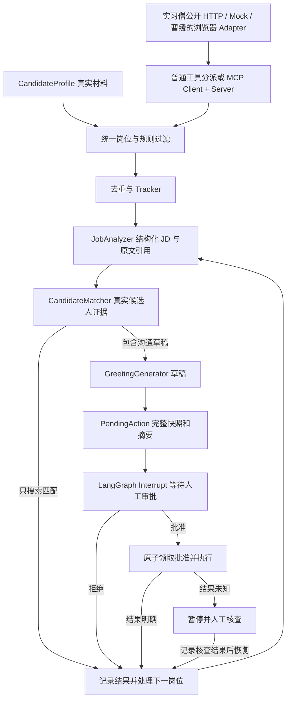

# JobPilot 架构说明

## 当前工作流

图遍历结束后进入 COMPLETED。真实发送执行器目前停在尚未验收的平台契约处；图中执行边已用模拟动作测试，不能理解为真实平台发送已可用。

当前先跑通一个真实来源：实习僧。`PublicPageReader` 只发送公开 GET，校验平台主机和路径、限制跳转与正文大小、请求至少间隔一秒。401/403/429 或登录验证会暂停，不切换指纹、不解验证码，也不读取浏览器 Cookie。`ShixisengAdapter` 从列表取编号，再解析详情；特殊字体不能可靠解释时停止或将可选字段保留未知。两种读取器共享 `PageReader` 契约，后面的服务不依赖传输方式。

Dashboard 默认 `analysis_only=true`；CLI 使用 `--analysis-only`。该模式在分析后直接进入下一岗位，不创建草稿或 PendingAction。原有任务和未指定该字段的 API 请求保持旧流程。`discovery` 与 `rejected_jobs` 保存读取数、排除原因和去重数，避免把零匹配误判成零数据。这里只验证技能证据，不能据此认定学历、毕业年份、语言或招聘有效期均符合。

| 层 | 职责与边界 |
| --- | --- |
| models | Pydantic 领域数据，不携带连接、浏览器或密钥 |
| adapters + browser | 读取各平台页面并标准化；选择器集中在 selectors.py |
| llm | OpenAI 兼容严格 JSON Schema；offline 只是有限词表替身 |
| services | 确定性规则、引用校验、技能匹配、草稿与审批，不依赖招聘网站 |
| tools | 普通 Tool Calling 的本进程参数校验和方法分派 |
| mcp_client / mcp_server | 同一组只读工具的真实 MCP 握手、stdio 和子进程传输 |
| workflow | LangGraph 的 State、Node、Edge、Loop、Interrupt 与恢复 |
| storage + migrations | 业务关系表、审批事务和版本化迁移；检查点交给 LangGraph Saver |
| api + web | 单机令牌鉴权、有限工作线程、状态查询、SSE 与中文界面 |
| evaluation | 人工标注合成样本、独立指标、恢复注入与浏览器验证 |

## 证据和副作用约束

简历入口先提取文本或 DOCX 正文，再由用户标注技能、程度和原文引用。`resume_service` 检查引用逐字存在、技能名称完整出现且没有重复；不进行模型推断。`/api/resume/extract` 和 `/api/resume/profile` 复用 API 鉴权，前者逐块限制上传，后者只返回候选人 JSON。原始文件不落盘，开始任务才保存确认后的资料。已有 CandidateProfile 和匹配服务无需依赖文档格式；引用一致只能证明来源，语义和经历真实性仍由本人核对。

JD 结构化输出仍要逐项核对原文引用。CandidateMatcher 只匹配 CandidateProfile 中明确出现的技能与证据；学习中的技能不能升级成已熟练。模型只选择草稿证据编号，程序引用用户原文组织文本，不自由补写项目经历。Pydantic 保证结构，不保证经历真实，输入材料的事实仍需用户确认。

PendingAction 保存候选人、岗位、正文和证据的完整快照，SHA-256 摘要绑定审批内容。批准不等于立即可靠送达。执行器先原子地将 APPROVED 改为 EXECUTING，只读预检查失败可以恢复批准；进入发送后任何未知结果都成为 UNCERTAIN，禁止自动重试。

EXECUTING/UNCERTAIN 会中断图。人工核查接口取得同一工作流锁，再核对摘要、保存核查人和依据。确认未发送会终结该动作，后续重新发送需要新任务与新批准。Tracker 随分析和草稿推进；只有非模拟动作的成功回执或人工送达确认才记录 CONTACTED，不覆盖已经记录的面试、归档等进展。

## 状态、恢复和数据库

AgentState 只保存 JSON 数据，完整图状态由 thread_id 对应检查点持久化。恢复时使用原来的 run_id、source、mode、transport 和数据目录。Resume 不能批准动作，也不会重发未知结果。读取节点遇到登录或验证码时中断；模型暂时失败保留失败节点，按恢复位置继续。

原 Phase 1 SQLite 文件保持兼容。后续支持关系后端 pending_actions、agent_candidates、agent_jobs、agent_applications、agent_runs；SQLAlchemy 负责方言差异，Alembic 负责业务表升级。SQLite 初始化也通过迁移，旧的无版本库只有结构完全吻合已知版本才补记版本，否则保留数据并停止。PostgreSQL Saver 单独维护检查点结构。

CLI 的历史默认库和 API 的默认库不同，详见 demo.md，不能只拿相同 run_id 就假定共享同一任务。Checkpoint 不是数据库备份；迁移不自动搬迁历史库。

## 浏览器和运行边界

浏览器资料按平台独立保存，文件锁阻止同一资料并发打开，Chromium 沙箱显式启用。普通 Edge 人工登录只启动可见窗口，不自动填写认证表单。后续读取仍受可信 HTTPS 主机校验、请求数量上限和导航间隔约束。空白页、登录验证、拒绝访问或选择器缺失都明确暂停或报错，不伪装成空岗位列表。

页面就绪要求结果元素可见，BOSS 导航栏中的 `/job_detail/` 入口和隐藏空结果模板不算岗位结果；检查验证弹窗时考虑所有匹配元素，避免漏掉隐藏模板之后的可见弹窗。`browser_cli diagnose` 只访问一次主页并观察主框架导航，遇到异常即停；本机报告仅含类别和有限状态，不保存原始 URL 或认证资料，也不把打开页面当成登录验收。

API 默认只监听本机，校验令牌、Host、Origin 和请求频率；界面用 textContent 展示外部内容。同步图放入单个受限工作线程，SSE 异步输出状态快照。日志轮转且只记录白名单字段，密钥和简历正文不进入事件日志。

SSE 连接定期结束后，页面先读取最新快照，任务仍执行时续接状态流；暂停、失败和完成时停止。连续三次网络错误会提示用户重新选择任务，切换任务时取消旧连接。续接只使用 GET，不重复执行任务、批准动作或发送消息。

当前没有多主机并发需求，因此使用文件锁和本机队列，没有引入 Redis。MCP 是接口与传输边界，不是权限沙箱；其工具不暴露任意 URL、脚本或外部发送。容器和真实 PostgreSQL 尚未在本机验收。

评估门禁独立于指标计算：`evaluation/gates.py` 读取阈值，检查测量分母、有限数值和上下限。零候选人证据幻觉是不可关闭的约束。离线基线只用于发现回归；真实服务未测时不会把未知用量或成本写成成功。CLI 出错也写入失败报告并返回非零，CI 可以据此阻止发布。

恢复请求先持久化 QUEUED，再提交后台线程，因此返回 202 后不会仍显示上一轮的 PAUSED。若线程池已关闭，恢复原状态并明确报错。部署验收使用独立 Compose 项目和随机测试凭据，不读取个人 .env 或复用数据卷；HTTP 恢复客户端仅允许本机回环地址和 Mock 操作。

## Phase 0、1 原始 CLI 设计记录

下文保留最初阶段的设计说明，仅描述原 `app.main`。其中“后续阶段”是当时的规划；当前实现和限制以上文及 phases.md 为准。

当前数据流是同步的普通 Python 调用。没有后台 Agent、浏览器或 API 服务。候选人配置和 Mock 岗位均从本地 UTF-8 JSON 读取，输出是 CLI 展示与 SQLite 记录。

## 模型为什么用 Pydantic

`DomainModel` 统一禁止未知字段并开启赋值校验，尽早发现配置拼写错误。核心字符串不允许空值，天数限于 1–7，月份必须为正整数，时间必须携带时区。`CandidateSkill` 将技能、用户自述等级和证据放在一起，避免只有标签、没有依据。

`JobPosting` 不含 selector、浏览器对象或候选人数据。空 JD 可以进入模型，随后由 RuleFilter 给出明确的拒绝原因。`Application` 通过 candidate_id 与 job_id 表示某个候选人的状态，而不是让岗位自身携带全局申请状态。

Pydantic 不证明输入经历真实；它只保证结构与字段约束。后续生成模块还必须只引用用户提供的事实。

## Adapter 为什么只负责读取

`JobSourceAdapter` 定义 search_jobs 和 get_job_detail；Mock 实现按文件名稳定排序，整批校验 JSON。如果一个文件损坏，报告文件名并停止，避免误把部分数据当成完整结果。

本轮不创建 BOSS 空壳或 prepare/send 方法，因为这些属于后续 Phase。未来平台 Adapter 只需输出相同 JobPosting，过滤、去重、存储无需知道平台页面结构。

## 规则为什么独立于 Adapter

`normalize_job` 清理格式与 URL；`RuleFilter` 接收候选人和岗位，返回 passed 与全部 reasons。排除岗位检查标题，排除关键词检查标题和 JD；标题须包含目标岗位或显式配置的偏好词之一。英文匹配有词边界，避免 AI 意外命中 retail。

城市支持杭州、上海、深圳的英文别名以及 Remote/远程等显式别名，不猜测任意位置。明确的实习岗位会检查候选人的时长与每周到岗约束；缺失元数据按未知保留。示例中的 preferred_keywords 参与粗筛，并非技能匹配分数。

标准化、过滤、去重都是纯本地确定性操作，因此不需要 LLM，也不需要为这些步骤引入框架。

## 去重如何识别同一岗位

本批次按 `(source, source_job_id)` 或 canonical URL 判断重复，保留第一次出现的记录。URL 删除 fragment 和已知跟踪参数（utm_*、gclid 等），保留 id/job_id 等身份查询参数；不通过公司、标题和城市猜测两个招聘编号相同。

数据库以 `(source, source_job_id)` 唯一约束保证跨次运行的幂等性，另外在写事务内比较已有岗位的规范 URL。再次导入相同平台岗位或 URL 别名时，保留最初的本地 ID 与平台身份，更新岗位快照，维护既有申请链接。`resolve_job_id` 让 CLI 使用已保存的身份创建或读取申请，不会因编号别名重新生成 NEW 状态。URL 比较采用简单扫描，适合当前 20 个岗位的规模；跨平台 duplicate_group_id 和岗位编号/URL 的完整别名历史尚未实现。

## SQLite 为什么足够

本阶段仅本地同步读写，标准库 sqlite3 即可。候选人与岗位保存为 JSON，业务身份放在关系字段中；申请表保存状态、时间、备注和最后动作。

约束：jobs 的平台身份唯一；applications 的候选人/岗位组合唯一；外键拒绝不存在的候选人或岗位。所有写 SQL 使用参数绑定。每个写方法独立开启事务，save_jobs 中任一冲突会回滚整个岗位批次。上下文管理器负责关闭连接，不表示整个搜索是单个事务。

搜索中断后可以再次运行，唯一约束会阻止重复记录；这还不是 Agent checkpoint 恢复。现阶段没有 AgentRun、状态迁移工具或 PostgreSQL。

## 状态与用户确认

搜索后自动创建 NEW 记录，仅表示“已纳入本地跟踪”。所有手动状态/备注修改都要求 `confirmed=True`；CLI 只有同时给出具体 `--set-status ID STATUS --confirm` 才会传递此值。

这是一款本地 CLI 的交互契约，不是多用户认证机制，也不是外部动作批准令牌。状态允许列表位于 tracker.py，阻止 NEW 直接变成 OFFER 等无效流转。记录 CONTACTED 仅用于用户录入线下进展，不调用任何外部平台。

后续 Phase 4 才会加入 PendingAction 和对具体待发送内容的批准；当前没有发送/投递执行能力。

## 配置、日志与异常

配置按环境变量、项目 .env、默认值依次取值，不修改进程环境。标准库 logging 输出 run_id、节点/工具、计数、耗时和失败原因，DEBUG 额外记录 job_id 及过滤结果。CLI 展示集中在 main.py 使用 print，其他模块不直接展示业务结果。

可预期错误使用 JobPilotError 子类，CLI 返回非零退出码。候选人校验只报告字段位置，不输出完整个人资料。默认测试完全离线；真实浏览器测试在将来的 Phase 3 单独建立。
